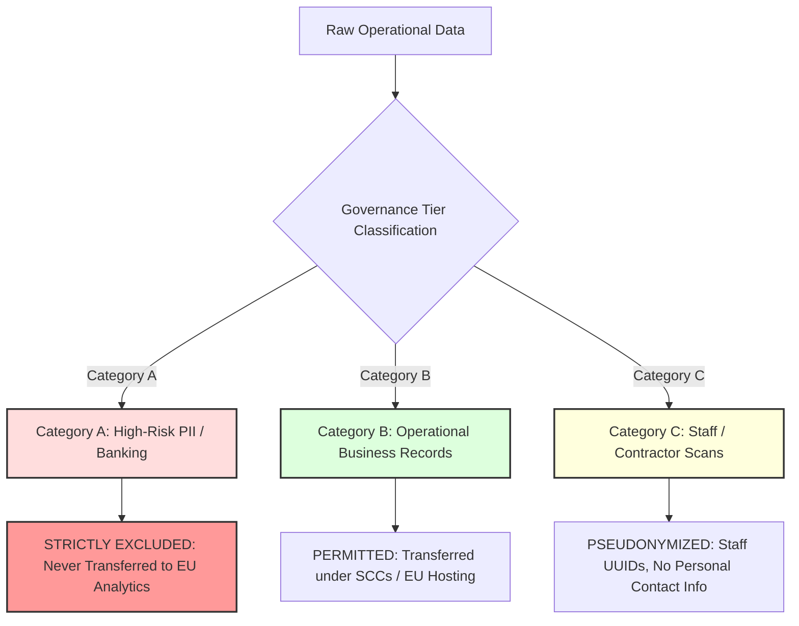

# Data Governance, GDPR Compliance & US-EU Cross-Border Transfer Review
**Document ID:** GOV-DPA-V1-2026-10-20  
**Target Systems:** Jarvis v1 Orchestration Platform, Supabase Managed Cloud (`eu-central-1`)  
**Legal Framework:** General Data Protection Regulation (GDPR - EU 2016/679), CCPA/CPRA, EU-US Data Privacy Framework (DPF)  
**Classification:** PRIVILEGED & CONFIDENTIAL — LEGAL & TECHNICAL COMPLIANCE

---

## 1. Architectural Sovereignty & Hosting Baseline

Meridian Supply Chain operates physical fulfillment centers and partner relationships in the United States (Pennsylvania, Nevada). However, the primary enterprise analytics database and pgvector memory cluster are provisioned in **Supabase EU Central (Frankfurt, Germany - `eu-central-1`)**.

This cross-border topology necessitates strict technical and operational controls to ensure compliance with European and United States privacy statutes.

---

## 2. Data Categorization & Transfer Boundaries

All data elements ingested into Jarvis v1 are categorized into three distinct governance tiers:

### 2.1 Category A: High-Risk PII & Banking Records (Strict Exclusion)
- **Elements:** Bank routing numbers, checking account numbers, social security numbers (SSN), taxpayer identification numbers (EIN), photographic identity document URLs, unredacted postal addresses.
- **Source Tables:** `seller_db.members`, `seller_db.payout_methods`, `seller_db.payouts (account fields)`.
- **Governance Mandate:** **PERMANENT ZERO-SYNC POLICY.** These fields are hard-excluded at the database replica boundary. They are never ingested into the Supabase EU analytics cluster, never vectorized into pgvector, and never transmitted to LLM API endpoints.

### 2.2 Category B: Operational Business Records (Permitted Transfer)
- **Elements:** Normalized product SKUs, wholesale order totals, package tracking numbers, inventory valuation, facility codes, invoice dates.
- **Source Tables:** `portal_db.orders`, `portal_db.catalog_products`, `wms_db.inbound_packages`, `wms_db.outbound_shipments`.
- **Governance Mandate:** Permitted for replication to the Supabase EU Central cluster under the EU-US Data Privacy Framework (DPF) and Standard Contractual Clauses (SCCs).

### 2.3 Category C: Staff & Contractor Operational Records (Pseudonymized Transfer)
- **Elements:** Warehouse badge IDs, packing timestamps, picker productivity metrics.
- **Source Tables:** `wms_db.outbound_lines.packed_by`, `seller_db.submissions.processed_by`.
- **Governance Mandate:** GDPR Article 6(1)(f) Legitimate Interests. Transferred using deterministic pseudonyms (`STAFF_HASH_KEY`) to prevent individual worker surveillance without operational justification.

---

## 3. LLM Gateway & Cloud Inference Zero Data Retention (ZDR)

When Jarvis routes queries and retrieved context to cloud foundation models (Anthropic Claude, OpenAI GPT-4o, Google Gemini):
1. **Commercial Zero Data Retention:** Commercial enterprise API agreements must enforce ZDR (Zero Data Retention) where prompt and completion tokens are discarded immediately post-inference and not logged for model training.
2. **Client Redaction Pre-Processor:** Before passing any context to an LLM provider, text is processed through the local NER scrubber:
   - Regex matches for email addresses are masked as `[REDACTED_EMAIL]`.
   - 10-digit phone numbers and 9-digit SSN formats are masked as `[REDACTED_ID]`.
3. **No Cross-Border PII Transmission:** Under no circumstances may raw European citizen PII be forwarded to non-EU LLM endpoints without explicit legal basis and encryption in transit.

---

## 4. Compliance Checklist Prior to Phase 1 Production

- [x] Dedicated read-only role (`jarvis_analytics_ro`) configured to block banking tables.
- [x] Supabase project pinned to region `eu-central-1` (Frankfurt).
- [ ] Execute formal Data Processing Addendum (DPA) with Supabase Inc.
- [ ] Execute Standard Contractual Clauses (SCCs) for transatlantic data flows between US fulfillment centers and EU analytics host.
- [ ] Enforce automated 90-day tombstone purge on semantic cache and conversational audit logs.
- [ ] Complete formal DPIA (Data Protection Impact Assessment) sign-off by Meridian Legal Counsel (`EMP-020`).
