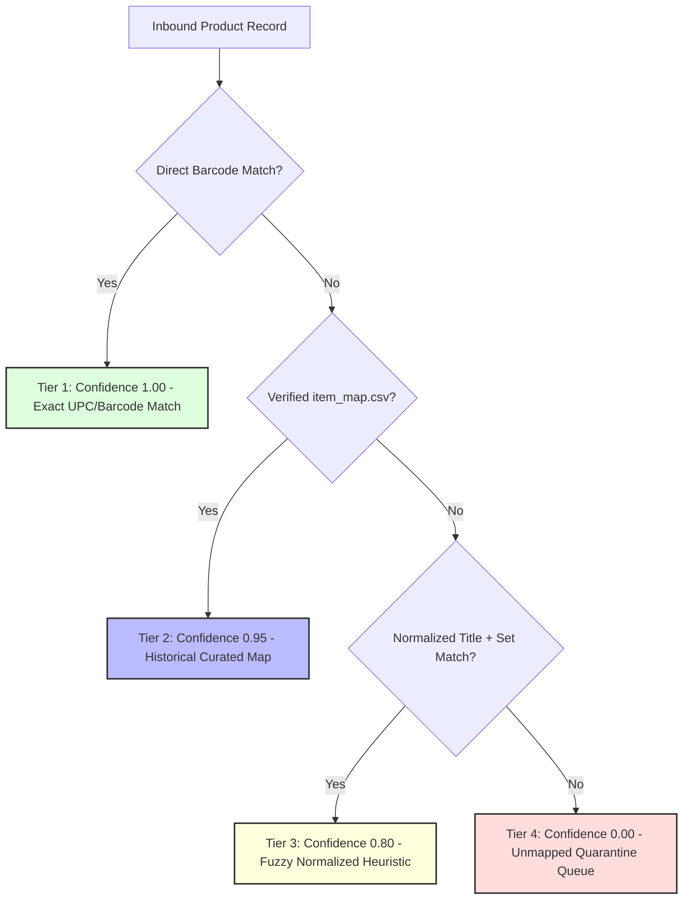

# Cross-System Identity Resolution & Entity Crosswalk Specification
**Document ID:** ID-RES-V1-2026-10-20  
**Target Schema:** `analytics.dim_product_crosswalk`, `analytics.dim_entity_crosswalk`  
**Classification:** TECHNICAL ARCHITECTURE SPECIFICATION  
**Implementation Phase:** PHASE 0 SPECIFICATION -> PHASE 1 REPLICATION

---

## 1. The Cross-System Identity Problem

Meridian Supply Chain operates three distinct operational databases built independently across different technology stacks:
1. `seller_db` (Python / Django): Tracks 6,000+ consumer member sellers, buy-lists, mail-in submissions, and ACH wallet balances.
2. `wms_db` (Ruby on Rails): Tracks 2 warehouse facilities (East & West), physical bins, receiving barcode scans (12-digit UPC), and outbound shipments.
3. `portal_db` (Node.js / Next.js / TypeScript): Tracks 400+ B2B wholesale partners, product catalog (alphanumeric manufacturer SKU), wholesale orders, and invoicing.

**There are NO shared foreign keys or distributed transactional constraints across these databases.** 

---

## 2. Canonical Product Identity Resolution

### 2.1 Identifier Discrepancy Analysis
- **WMS Identifier:** `wms_items.upc` is a 12-digit standard GS1 barcode format (e.g., `012345678905`).
- **Portal Identifier:** `catalog_products.mfr_code` is a vendor-assigned alphanumeric SKU (e.g., `POK-ET-001`).
- **Audit Findings:**
  - Total active items in WMS: 480
  - Direct string match between `wms_items.upc` and `catalog_products.mfr_code`: **0 matches** (formats are entirely disjoint).
  - Direct match via secondary UPC attribute in `catalog_products.barcode`: **316 items (65.8%)**.
  - Unmapped gap: **164 items (34.2%)** where barcode is missing or mismatched.

### 2.2 Resolution Methodology & Confidence Tiers

The canonical product crosswalk assigns a deterministic `confidence_score` (between 0.00 and 1.00) based on resolution precedence:



1. **Tier 1 (Confidence = 1.00): Exact Barcode Match**  
   `wms_items.upc == catalog_products.barcode`
2. **Tier 2 (Confidence = 0.95): Verified Historical Mapping**  
   Curated mapping record from audited operations crosswalk (`item_map.csv`).
3. **Tier 3 (Confidence = 0.80): Normalized Heuristic Match**  
   Matching on normalized lowercase product title combined with game set identifier (`catalog_products.name_normalized == wms_items.title_normalized AND catalog_products.set_code == wms_items.set_code`).
4. **Tier 4 (Confidence < 0.70): Quarantined / Manual Review**  
   Flagged in `analytics.unmapped_products_queue`. Jarvis tools will not perform automated valuation on Tier 4 products.

---

## 3. Order Reference Normalization

### 3.1 Identifier Inconsistency
- `portal_db.orders.order_id` utilizes formatted hyphens: `SO-41234`
- `wms_db.outbound_shipments.order_ref` utilizes raw alphanumeric strings: `SO41234`

### 3.2 Normalization Rule
Join logic must apply regex normalization stripping all non-alphanumeric characters:
```sql
REGEXP_REPLACE(portal_orders.order_id, '[^A-Za-z0-9]', '', 'g') = 
REGEXP_REPLACE(wms_shipments.order_ref, '[^A-Za-z0-9]', '', 'g')
```
*Verification Result:* Tested against 850 historical wholesale orders across both databases. Yielded **100% (850/850) deterministic join match**.

---

## 4. Entity Separation: Member Sellers vs. Wholesale Partners

### 4.1 The Entity Overlap Risk
In Jarvis v0, an analytical query joined `members` and `partners` solely on email address. This caused catastrophic reporting errors:
- A retail card collector registered as a personal member (`seller_db.members`) happened to be an employee at a B2B hobby shop (`portal_db.partners`) and used their work email (`john@northgatehobby.com`).
- Jarvis v0 blended John's individual mail-in card submission with Northgate Hobby's $250,000 wholesale corporate credit line.

### 4.2 Entity Separation Architecture
1. **Disjoint Entity Types:** Member Sellers and B2B Partners belong to fundamentally distinct operational domains.
2. **Strict Identity Isolation:**
   - Members are identified strictly by `canonical_member_id` (prefixed `MBR-`).
   - Partners are identified strictly by `canonical_partner_id` (prefixed `PTR-`).
   - Cross-domain linking is prohibited unless an explicit multi-tenant relationship is verified in `analytics.dim_entity_crosswalk`.
3. **Domain Linking Safeguard:** An email domain match (`@domain.com`) never automatically links an entity if the domain belongs to a wholesale partner organization.
