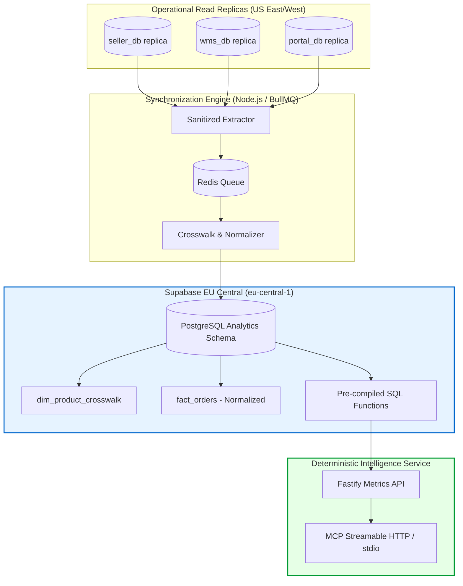

# Phase 1: Infrastructure, Data Foundation & Primary Synchronization Specification
**Document ID:** SPEC-PH1-V1-2026-10-20  
**Phase:** Phase 1 Implementation Specification  
**Branch:** `phase-1-infrastructure-sync`  
**Standard:** Enterprise Node.js / TypeScript, Fastify, Supabase PostgreSQL, BullMQ, Redis

---

## 1. Architectural Philosophy for Phase 1

> *"Jarvis must produce trustworthy business numbers before it attempts to behave like an intelligent business assistant."*

Phase 1 focuses entirely on the deterministic data backbone:
1. **Replica Extraction:** Controlled, read-only extraction of sanitized tables from the 3 operational database replicas (`seller_db`, `wms_db`, `portal_db`).
2. **Unified Analytics Datastore:** Ingestion into the Supabase EU Central PostgreSQL cluster under schema `analytics`.
3. **Canonical Crosswalk Execution:** Initialization of `analytics.dim_product_crosswalk` resolving 316 Tier 1 exact barcode matches and quarantining the 164 unmapped items.
4. **Deterministic Metrics API:** Implementation of the Fastify REST / MCP `execute_metric` service serving the 8 pre-compiled business queries.
5. **Scheduled Synchronization:** Resilient BullMQ workers with Redis caching and 15-minute polling cycles.

---

## 2. Phase 1 Implementation Work Breakdown

### Step 1: Infrastructure Setup (Week 1)
- Verify that Phase 1 Entrance Conditions (`COND-01` through `COND-05`) have sign-off evidence.
- Provision Supabase EU Central instance (`eu-central-1`).
- Execute `contracts/canonical_crosswalk.sql` on the Supabase cluster.
- Initialize Node.js TypeScript project structure in `packages/data-engine` and `packages/metrics-service`.

### Step 2: Primary Data Extraction & Sanitization (Week 1 - 2)
- Implement read-only database connectors using `pg` with connection pooling and 8,000ms timeouts.
- Create sanitization filters:
  - Mask emails using deterministic HMAC hashing (`sha256(email + pepper)`).
  - Exclude bank routing and account columns entirely.
  - Apply order reference regex normalization: `SO-41234` -> `SO41234`.

### Step 3: Canonical Crosswalk Population & Quarantine (Week 2)
- Populate `analytics.dim_product_crosswalk`:
  - 316 items mapped with `mapping_confidence = 1.00` and method `EXACT_UPC`.
  - 164 items flagged with `mapping_confidence < 0.70` and method `MANUAL_PENDING`.
- Export `reports/unmapped_products_quarantine.csv` for Ops Lead review.

### Step 4: Deterministic Metrics Service (Week 2 - 3)
- Port the 8 verified SQL metrics from `docs/audit/METRICS_DICTIONARY.md` into pre-compiled parameterized queries:
  1. `DAILY_PACKAGES_RECEIVED` (Facility-aware IANA timezones: `America/New_York` & `America/Los_Angeles`).
  2. `NET_PROFIT_GAAP` (Accrual accounting with closed-month validation).
  3. `BLOCKED_PAYOUTS_TOTAL` (NACHA format error tracking).
  4. `PARTNER_CREDIT_UTILIZATION` (Open AR & breach detection).
  5. `INVENTORY_HOLDING_RISK` (FIFO book value vs current FMV).
  6. `INBOUND_QUALITY_RATE`.
  7. `MEMBER_PAYOUT_VELOCITY`.
  8. `FULFILLMENT_FILL_RATE`.
- Expose endpoints via Fastify with Zod request validation.

### Step 5: Integration Testing & Ground Truth Verification (Week 3)
- Run `eval/baseline_eval.json` against the live metrics engine.
- Verify that:
  - Yesterday's packages (Oct 19) returns exactly 103 local packages (59 East, 44 West).
  - September net profit returns exactly $7,300.86.
  - Blocked payouts returns exactly 77 records ($173,339.51).
  - Northgate Hobby credit breach is flagged at $284,279.37.
