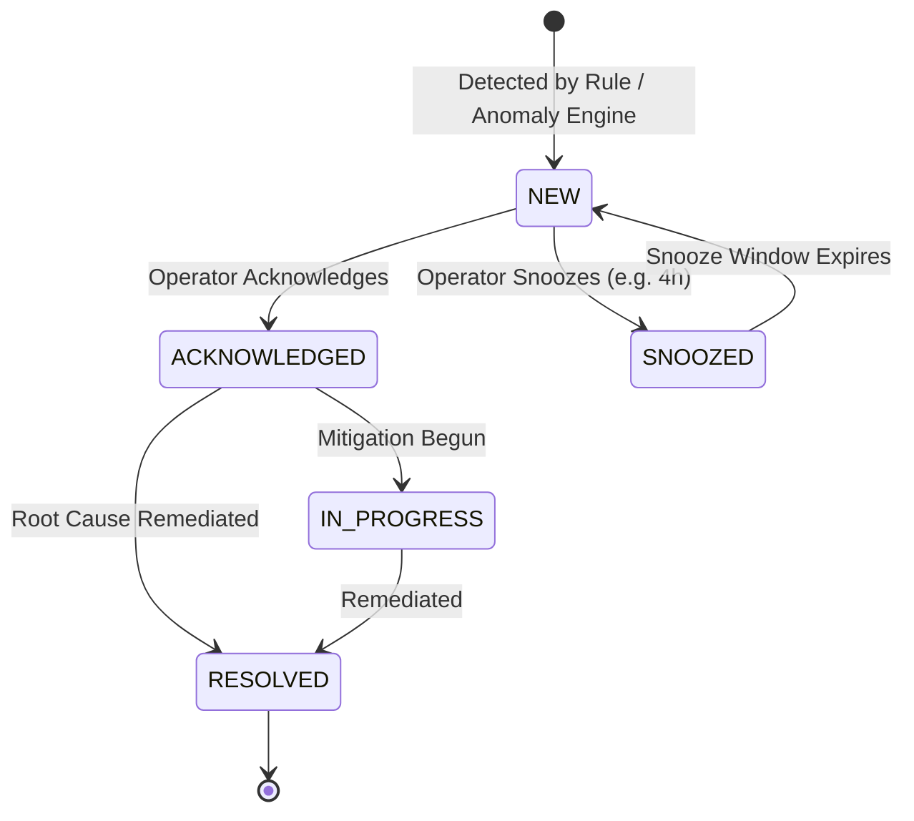

# Jarvis v1 — Alert Management System Documentation

## 1. Overview

The Central Alert Management System (`server/services/alerts/alert_manager.py`) coordinates event ingestion, deterministic deduplication, lifecycle transitions, snoozing, and operator feedback.

---

## 2. Deterministic Fingerprint Deduplication

To prevent alert storms across 15-minute and hourly execution cycles, every alert calculates a deterministic SHA-256 fingerprint:

$$\text{fingerprint} = \text{sha256}(\text{alert\_type} + ":" + \text{entity\_type} + ":" + \text{entity\_id} + ":" + \text{incident\_ref})[0:32]$$

### Database Enforcement
`jarvis_alerts.alert_history` enforces uniqueness on `fingerprint VARCHAR(128) UNIQUE`.
- **First Detection**: Inserts new record with `status = 'NEW'`, `occurrence_count = 1`.
- **Subsequent Detection**: Automatically updates `last_detected_at = NOW()`, increments `occurrence_count = occurrence_count + 1`, and refreshes payload details without generating a duplicate database record.

---

## 3. Alert Lifecycle States

### Lifecycle Actions & Feedback
- `ACKNOWLEDGE`: Confirms visibility without clearing warning.
- `SNOOZE`: Suppresses adapter dispatch and feed visibility until `snoozed_until`.
- `RESOLVE`: Marks issue resolved with timestamp and resolution notes.
- `FEEDBACK`: Logs operator categorization (`NOTE`, `FALSE_POSITIVE`).
