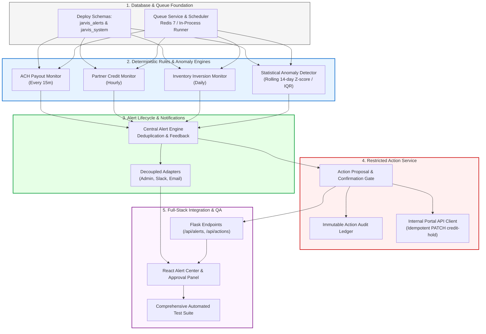

# Jarvis v1 — Phase 2 Project Discovery & Architectural Blueprint
**Document ID:** DISC-PH2-V1-2026-11-06  
**Project:** Jarvis v1 Enterprise Proactive Intelligence & Action Platform  
**Client:** Meridian Supply Chain (MSC)  
**Author:** Senior Backend Architect, Distributed Systems Engineer & Security Specialist  
**Status:** COMPLETE & VERIFIED BASELINE

---

## 1. Existing System Architecture & Operational State

The Phase 1 data foundation for Meridian Supply Chain is fully operational and running live on the `phase-1-infrastructure-sync` branch:

```
+-----------------------------------------------------------------------------------+
|                        CURRENT PHASE 1 VERIFIED ARCHITECTURE                      |
|                                                                                   |
|   React 18 + Vite Client (:3001) <====== HTTP / REST ======> Flask Backend (:5000)|
|   [Founder Cockpit, Metrics, Crosswalk]                     [Threaded Pool, RPC]  |
|                                                                      |            |
|                                                               TLS 1.3 | Supavisor |
|                                                                      v            |
|               Supabase Cloud Managed PostgreSQL 17.11 Cluster                     |
|   +-----------------------------------------------------------------------------+ |
|   | staging_* (35 tables, 67,758 rows) | analytics.* (4 Dims, 6 Facts, 3 MVs)   | |
|   | vector.* (pgvector active)         | app.* (Jarvis app state)               | |
|   +-----------------------------------------------------------------------------+ |
+-----------------------------------------------------------------------------------+
```

### Verified Live Endpoints & Performance:
- **Backend Server:** Python Flask running on `http://127.0.0.1:5000` with psycopg2 `ThreadedConnectionPool` (Direct: 5432, Supavisor Transaction Pooler: 6543).
- **Frontend Dashboard:** React 18 running on `http://localhost:3001` with Vite proxying `/api` -> `:5000`.
- **Database Engine:** PostgreSQL 17.11 on `x86_64-pc-linux-gnu` with `uuid-ossp` and `vector` extensions active.
- **Data Ingestion:** 67,758 rows across 35 staging tables with cryptographic PII email hashing.
- **Star Schema:** 4 dimensional tables, 6 fact tables, and 3 materialized views (`mv_daily_receiving_summary`, `mv_partner_ar_aging`, `mv_fifo_inventory_valuation`) populated and verified.
- **Reconciliation Engine:** Automated source-to-analytics reconciler running in 6.37s with **0 discrepancies across 9 target tables (100% match)**.
- **Baseline Evaluation:** 10 out of 10 test scenarios passed live with a 100% score (`eval/phase1_execution_results.json`).

---

## 2. Reusable Phase 1 Modules for Phase 2

| Module Path | Technology | Phase 2 Reusability |
| :--- | :--- | :--- |
| `server/services/db_pool.py` | Python / psycopg2 | Provides thread-safe, read-only connections with 8,000ms timeouts for rules engine workers. |
| `server/services/metrics_engine.py` | Python / Parameterized SQL | Provides the 15 verified metrics, facility IANA timezones, and analytical aggregations. |
| `server/services/crosswalk_service.py`| Python / Regex | Provides canonical product lookups, UPC <-> SKU resolution, and order reference normalization. |
| `server/services/reconciliation/` | Python / Supabase | Provides audit logging, execution history, and discrepancy tracking patterns. |
| `contracts/canonical_crosswalk.sql` | PostgreSQL DDL | Underlying catalog dimension used by inventory price inversion checks. |
| `client/src/components/*` | React 18 / Vite | Modular UI architecture ready to host the new Alert Center and Action Approval Panel. |

---

## 3. Existing Database Tables & Schemas

The single database architecture currently contains:
- **`staging_seller` (10 tables):** `members`, `payout_methods`, `buy_list`, `buy_list_changes`, `submissions`, `submission_items`, `payouts`, `wallet_ledger`, `support_tickets`, `staff_users`.
- **`staging_wms` (9 tables):** `warehouses`, `wms_items`, `bins`, `inbound_packages`, `package_lines`, `stock_levels`, `outbound_shipments`, `outbound_lines`, `wms_users`.
- **`staging_portal` (16 tables):** `brands`, `sets`, `catalog_products`, `listed_stock`, `partners`, `partner_users`, `quotes`, `quote_items`, `orders`, `order_items`, `invoices`, `payments`, `partner_messages`, `market_prices`, `price_index`, `staff_users`.
- **`analytics` (13 objects):** `dim_members`, `dim_partners`, `dim_warehouses`, `dim_products`, `dim_product_crosswalk`, `fact_dock_receipts`, `fact_inspections`, `fact_orders`, `fact_invoices`, `fact_payouts`, `fact_cost_layers`, and 3 materialized views.

---

## 4. Missing Dependencies & Environmental Requirements

| Dependency / Capability | Current Status | Phase 2 Implementation Strategy |
| :--- | :--- | :--- |
| **Redis 7 Store** | Not running locally on Windows host | Implement `server/services/queue/redis_queue.py` with `REDIS_URL` support and robust in-process fallback scheduler; provide standalone TypeScript BullMQ worker under `services/workers/`. |
| **Alert Schemas** | Not yet created in PostgreSQL | Deploy migration `database/migrations/002_jarvis_alerts_and_actions.sql` creating schemas `jarvis_alerts` and `jarvis_system`. |
| **Slack Webhook / Bot** | Credentials not yet supplied | Implement decoupled `SlackNotificationAdapter` with Slack Block Kit formatting, signature verification, and mock transport mode. |
| **Internal Portal API** | Production credentials restricted | Implement `InternalPortalClient` targeting `PATCH /api/v1/partners/{partner_id}/credit-hold` with idempotent mock adapter for staging execution. |
| **Email Delivery** | SMTP credentials unconfigured | Implement provider-independent `EmailNotificationAdapter` with mock delivery logger. |

---

## 5. Security & Architectural Constraints

1. **Zero LLM Database Write Access:** The Large Language Model has zero direct database write credentials and cannot trigger mutating API calls.
2. **Restricted Action Service Gate:** Any operational action (such as `ACTION_CREDIT_HOLD` on partner 301) must pass through a multi-step confirmation lifecycle: `PROPOSED` -> `PENDING_CONFIRMATION` -> `EXPLICIT_HUMAN_APPROVAL` -> `IDEMPOTENT_EXECUTION`.
3. **Role-Based Authorization:** Credit hold confirmation is restricted strictly to `ROLE_FOUNDER` and `ROLE_SALES`. Roles must be verified server-side, never trusted from client request payloads.
4. **Append-Only Action Audit Ledger:** All proposed, confirmed, canceled, and executed actions are permanently recorded in `jarvis_system.action_audit_ledger` with immutable timestamps and idempotency keys (`idemp_<uuid>`).
5. **Alert Deduplication:** All emitted alert events use deterministic fingerprinting (`sha256(alert_type + entity_id + window)`) to prevent alert flooding.

---

## 6. Phase 2 Implementation Plan


