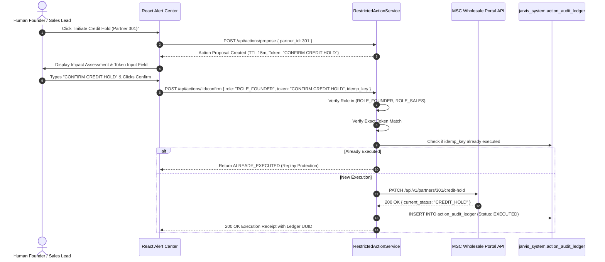

# Jarvis v1 — Restricted Action Service & Human-Gated Execution

## 1. Security Architecture

The Restricted Action Service (`server/services/actions/restricted_action_service.py`) protects Meridian's core operational systems against unauthorized or automated LLM state changes.

### Fundamental Security Invariant
> **LLM agents possess zero direct execution credentials or write authority.**
> Every business state transition must be proposed, reviewed, explicitly confirmed by an authorized human operator with exact token matching, executed idempotently, and permanently recorded in an immutable append-only ledger.

---

## 2. Seven-Step Confirmation Lifecycle

---

## 3. Verified Target Case: Partner 301 (Northgate Hobby Distributors)

- **Partner ID**: `301`
- **Partner Tier**: `gold`
- **Credit Limit**: **\$250,000.00**
- **Open AR Balance**: **\$284,279.37**
- **Credit Utilization**: **113.71% (CRITICAL BREACH)**
- **Overdue >60 Days**: **\$26,475.94** (across 26 open invoices)
- **Direct Operational Impact**: Freezes wholesale portal ordering and warehouse shipping releases until overdue balance is settled.
- **Idempotency Protection**: `idempotency_key` guarantees duplicate execution attempts return the original transaction receipt without double-dispatching downstream.
