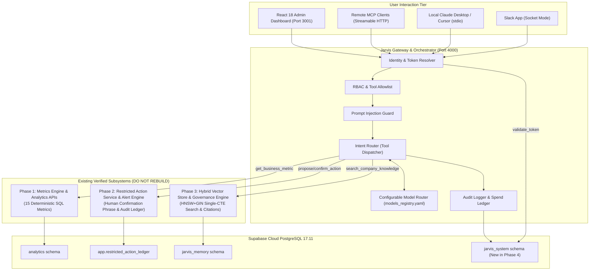

# Jarvis v1 — Phase 4 Gateway & MCP Architecture

**Target Release:** `v0.4.0-phase4-gateway`  
**Author:** Principal AI Systems Architect  
**Status:** Approved Architecture  

---

## 1. System Topology Overview

Phase 4 implements the centralized **Jarvis Gateway and Orchestrator** in Node.js/TypeScript using Fastify. It connects multiple enterprise AI client interfaces (Claude Desktop, Cursor, Slack, and Web Browsers) to existing Meridian Supply Chain intelligence capabilities while enforcing authentication, employee identity propagation, RBAC, model routing, and immutable audit tracking.



---

## 2. Key Architecture Pillars

### 2.1 Non-Duplication Mandate
The gateway is an **Orchestrator, Security Boundary, and Protocol Adapter**. It never duplicates or computes business metrics, action executions, or vector searches independently. All business operations are dispatched to existing verified services via authenticated service-to-service calls.

### 2.2 Strict Identity Binding
Every request across all transports must resolve to an authenticated corporate employee record:
```typescript
interface UserContext {
  userId: string;
  email: string;
  role: UserRole;
  department: string;
  allowedScopes: string[];
  tokenId: string;
  requestId: string;
  clientType: 'SLACK' | 'MCP_STREAM' | 'MCP_STDIO' | 'ADMIN_UI' | 'API';
}
```

### 2.3 Universal Security Pipeline
$$\text{Request} \longrightarrow \text{Token Auth} \longrightarrow \text{Identity Resolver} \longrightarrow \text{RBAC Validator} \longrightarrow \text{Prompt Guard} \longrightarrow \text{Service Dispatch} \longrightarrow \text{Audit Logger}$$

---

## 3. Communication Protocols
- **Internal Service-to-Service:** Fastify Gateway communicates with Flask Backend (`http://127.0.0.1:5000`) over HTTP with internal security header `X-Jarvis-Internal-Gateway: true`.
- **External Local MCP:** Official `@modelcontextprotocol/sdk` StdioServerTransport.
- **External Remote MCP:** Official Streamable HTTP transport at `/mcp/stream` with 15-second keepalive pings.
- **Slack Client:** `@slack/bolt` in Socket Mode via secure outbound WebSocket connection.
