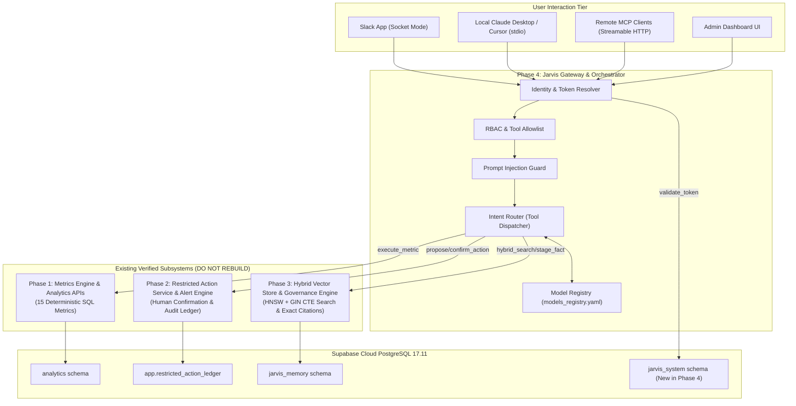
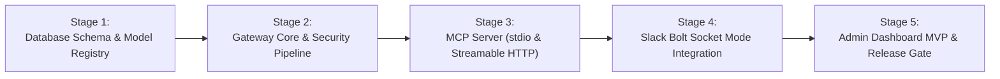

# Jarvis v1 — Phase 4 Discovery & Baseline Architecture Document
## Exact Interface Catalog (Phases 1–3) and Gateway Orchestration Specification

**Author:** Principal AI Systems Architect, Distributed Systems Engineer  
**Date:** November 6, 2026  
**Document Status:** Approved Baseline Architecture  
**Target Subsystem:** Phase 4 — Jarvis Gateway, MCP Protocol, Model Registry & Admin Panel  

---

## 1. Executive Summary & Core Architectural Principle

Phase 4 introduces the centralized **Jarvis Orchestrator and Gateway**, exposing modern Model Context Protocol (MCP) transports (`Streamable HTTP` and `stdio`), an interactive Slack Bolt application in Socket Mode, a dynamic Model Registry (`models_registry.yaml`), and an Admin Dashboard MVP.

### The Non-Duplication Mandate
> **CRITICAL ARCHITECTURAL PRINCIPLE:**  
> The Jarvis Gateway is strictly an **Orchestrator, Security Boundary, and Protocol Adapter**.  
> The Gateway **MUST NEVER duplicate or re-implement business logic** already built and verified in Phases 1, 2, and 3.

Specifically, the Gateway reuses:
1. **Phase 1's Deterministic Metrics Registry & Execution Engine:** The gateway routes operational metric queries to approved SQL functions in `services.metrics_engine`. It never allows the LLM to write synthetic SQL or compute metrics independently.
2. **Phase 2's Restricted Action Service & Immutable Ledger:** The gateway routes mutation requests to `services.action_service`, strictly enforcing explicit human confirmation phrases, role permissions, and immutable logging in `app.restricted_action_ledger`.
3. **Phase 3's Hybrid RAG Retrieval & Memory Governance:** The gateway routes knowledge inquiries to `services.rag.vector_store` and memory candidates to `services.rag.knowledge_promoter`. All returned RAG contexts must preserve the certified citation contract.



---

## 2. Phase 1 Reusable Interfaces: Deterministic Metrics & Analytics

Phase 1 provides the authoritative business metrics for Meridian Supply Chain.

### 2.1 Python Service Interface
- **Module:** `services.metrics_engine`
- **Primary Functions:**
  ```python
  def list_registered_metrics() -> list[dict]:
      """
      Returns the catalog of all 15 certified deterministic metrics,
      including metric_id, name, description, unit, and required parameters.
      """

  def execute_metric(metric_id: str, params: dict = None) -> dict:
      """
      Executes the pre-approved deterministic SQL for metric_id against
      analytics tables (e.g. fact_orders, fact_dock_receipts, fact_invoices).
      
      Parameters:
        metric_id: e.g. 'DAILY_PACKAGES_RECEIVED', 'FIFO_INVENTORY_VALUATION', 'PARTNER_AR_AGING'
        params: e.g. {'start_date': '2026-08-01', 'end_date': '2026-08-31', 'warehouse_id': 'WH-01'}
      
      Returns:
        {
          "metric_id": str,
          "metric_name": str,
          "value": float | int | list,
          "unit": str,
          "calculated_at": str (ISO-8601),
          "parameters_used": dict
        }
      """
  ```

### 2.2 REST Endpoints
| Endpoint | Method | Payload / Parameters | Response |
|---|---|---|---|
| `/api/metrics/list` | `GET` | None | Array of 15 metric metadata definitions |
| `/api/metrics/execute` | `POST` | `{"metric_id": "M...", "params": {...}}` | Calculated metric value with execution timestamp |
| `/api/sync/status` | `GET` | None | Ingestion status, CDC replication lag, and staging row counts |
| `/api/crosswalk/products` | `GET` | `?sku=...` or `?seller_id=...` | Canonical product mapping across Seller, WMS, and Portal |
| `/api/crosswalk/order` | `GET` | `?order_id=...` | Resolved cross-system order lineage |

### 2.3 Phase 4 Gateway Tool Contract
- **MCP Tool Name:** `execute_metric`
- **Description:** Retrieve certified operational metrics for Meridian Supply Chain.
- **Input Schema:**
  ```json
  {
    "type": "object",
    "properties": {
      "metric_id": {
        "type": "string",
        "enum": [
          "DAILY_PACKAGES_RECEIVED",
          "DAILY_UNITS_RECEIVED",
          "WAREHOUSE_RECEIVING_SUMMARY",
          "PARTNER_AR_TOTAL",
          "PARTNER_AR_AGING",
          "FIFO_INVENTORY_VALUATION",
          "ORDER_FULFILLMENT_CYCLE_TIME",
          "DOCK_TO_STOCK_HOURS",
          "INSPECTION_FAILURE_RATE",
          "DIRECT_MARGIN_RATE",
          "CONSIGNMENT_PAYOUT_VOLUME",
          "STORAGE_REVENUE_ACCRUED",
          "OVERDUE_INVOICE_BALANCE",
          "CROSS_FACILITY_TRANSFER_RATE",
          "RETURN_TO_VENDOR_VOLUME"
        ]
      },
      "params": {
        "type": "object",
        "properties": {
          "start_date": {"type": "string", "description": "YYYY-MM-DD"},
          "end_date": {"type": "string", "description": "YYYY-MM-DD"},
          "warehouse_id": {"type": "string"},
          "partner_id": {"type": "string"}
        }
      }
    },
    "required": ["metric_id"]
  }
  ```

---

## 3. Phase 2 Reusable Interfaces: Restricted Actions & Alert Engine

Phase 2 enforces the zero-trust execution principle: **The LLM never writes directly to the database or executes unilateral business actions.**

### 3.1 Python Service Interface
- **Module:** `services.action_service`
- **Primary Functions:**
  ```python
  class RestrictedActionService:
      def propose_action(
          self,
          action_type: str,
          payload: dict,
          proposed_by: str,
          proposed_role: str,
          reason: str
      ) -> dict:
          """
          Proposes an action, validates RBAC, and generates a cryptographically
          secure, user-specific, single-use confirmation token.
          
          Returns:
            {
              "status": "PROPOSED",
              "action_id": str (UUID),
              "action_type": str,
              "required_confirmation": "CONFIRM <ACTION_TYPE>",
              "expires_at": str (ISO-8601),
              "summary": str
            }
          """

      def confirm_action(
          self,
          action_id: str,
          confirmation_token: str,
          executed_by: str,
          executed_role: str,
          idempotency_key: str = None
      ) -> dict:
          """
          Validates confirmation token, ensures executed_by matches or possesses
          approval authority, checks idempotency, executes mutation, and writes
          immutable record to app.restricted_action_ledger.
          """

      def cancel_action(
          self,
          action_id: str,
          cancelled_by: str,
          reason: str
      ) -> dict:
          """Cancels an unconfirmed proposed action."""

      def get_action_history(
          self,
          limit: int = 50,
          offset: int = 0,
          partner_id: str = None,
          action_type: str = None
      ) -> list[dict]:
          """Queries immutable audit ledger in app.restricted_action_ledger."""
  ```

### 3.2 REST Endpoints
| Endpoint | Method | Payload / Parameters | Response |
|---|---|---|---|
| `/api/actions/propose` | `POST` | `{"action_type": "...", "payload": {...}, "reason": "..."}` | Action proposal with required confirmation phrase |
| `/api/actions/pending` | `GET` | None | List of actions awaiting confirmation |
| `/api/actions/<id>` | `GET` | None | Specific action details and confirmation requirements |
| `/api/actions/<id>/confirm`| `POST` | `{"confirmation_token": "...", "idempotency_key": "..."}` | Execution result with immutable ledger sequence ID |
| `/api/actions/<id>/cancel` | `POST` | `{"reason": "..."}` | Cancellation confirmation |
| `/api/actions/history` | `GET` | `?limit=50&action_type=...` | Immutable ledger history |
| `/api/alerts` | `GET` | `?status=ACTIVE` | Active deterministic alerts and severity classifications |
| `/api/alerts/<id>/snooze` | `POST` | `{"snooze_until": "...", "reason": "..."}` | Snoozes alert with audit note |

### 3.3 Phase 4 Gateway Tool Contract
- **MCP Tool Name:** `propose_business_action`
  - Input: `action_type`, `payload`, `reason`
  - Output: Returns confirmation instructions for the human operator (e.g. *"Please confirm by typing: CONFIRM SET_PARTNER_CREDIT_HOLD"*).
- **MCP Tool Name:** `confirm_business_action`
  - Input: `action_id`, `confirmation_token`, `idempotency_key`
  - Output: Confirms execution and returns audit transaction ID.

---

## 4. Phase 3 Reusable Interfaces: Hybrid RAG & Knowledge Governance

Phase 3 provides verified operational knowledge retrieval across SOPs, partner contracts, incident post-mortems, and company memory.

### 4.1 Python Service Interface
- **Modules:** `services.rag.vector_store`, `services.rag.knowledge_promoter`
- **Primary Functions:**
  ```python
  class HybridVectorStore:
      def hybrid_search(
          self,
          query: str,
          top_k: int = 5,
          user_role: str = "ROLE_USER",
          sensitivity_filter: list[str] = None
      ) -> dict:
          """
          Executes combined CTE query (dense HNSW index + sparse GIN tsvector)
          in a single database roundtrip, applies Reciprocal Rank Fusion (RRF),
          and deterministic heuristic reranking.
          
          Enforces sensitivity levels:
            - ROLE_USER: PUBLIC, INTERNAL
            - ROLE_FINANCE/SALES: PUBLIC, INTERNAL, CONFIDENTIAL
            - ROLE_FOUNDER: PUBLIC, INTERNAL, CONFIDENTIAL, RESTRICTED_FOUNDER
          
          Returns:
            {
              "query": str,
              "results": [
                {
                  "chunk_id": str,
                  "content": str,
                  "source_name": str,
                  "document_title": str,
                  "section_path": str,
                  "citation": "Source: <file> (<ver>) -> <section>",
                  "rerank_score": float
                }
              ]
            }
          """

  class KnowledgePromoter:
      def stage_candidate_fact(
          self,
          candidate_fact: str,
          originating_user: str,
          session_id: str,
          category: str
      ) -> dict:
          """
          Stages a candidate fact into Tier 2 (jarvis_memory.candidate_facts).
          Checks for policy contradictions and triggers 3x corroboration auto-promotion.
          """

      def review_candidate(
          self,
          candidate_id: str,
          decision: str, # 'APPROVE' | 'REJECT'
          reviewer_id: str,
          reviewer_role: str,
          comments: str
      ) -> dict:
          """Allows Domain Leads to promote or reject staged facts."""
  ```

### 4.2 REST Endpoints
| Endpoint | Method | Payload / Parameters | Response |
|---|---|---|---|
| `/api/knowledge/retrieve` | `POST` | `{"query": "...", "top_k": 5}` | Chunks with citations, formatted for LLM context |
| `/api/knowledge/search` | `POST` | `{"query": "..."}` | Raw chunk search results |
| `/api/knowledge/sources` | `GET` | None | Registered document sources and status |
| `/api/knowledge/candidates` | `GET` | None | Staged candidate facts in Tier 2 |
| `/api/knowledge/candidates/<id>/approve` | `POST` | `{"comments": "..."}` | Promotes candidate to Tier 3 global memory |
| `/api/knowledge/candidates/<id>/reject` | `POST` | `{"comments": "..."}` | Rejects candidate and records justification |
| `/api/knowledge/memory` | `GET` | `?category=...` | Active approved global memory facts |

### 4.3 Phase 4 Gateway Tool Contract
- **MCP Tool Name:** `query_company_knowledge`
  - Input: `query` (string), `top_k` (int, default 5)
  - Output: Formatted markdown containing retrieved sections and mandatory citations.
- **MCP Tool Name:** `stage_knowledge_candidate`
  - Input: `candidate_fact` (string), `category` (string)
  - Output: Candidate staging confirmation and corroboration status.

---

## 5. Phase 4 Target Architecture & Subsystems

### 5.1 Protocol Adapters
1. **Streamable HTTP MCP Transport (`/mcp/stream`)**:
   - Modern MCP standard using `@modelcontextprotocol/sdk`.
   - Supports persistent bidirectional streaming, session resumption tokens, and keepalive pings every 15 seconds.
2. **Standard I/O Transport (`stdio`)**:
   - Packaged CLI wrapper (`gateway/bin/jarvis-mcp-stdio.ts` or executable) enabling seamless integration with local Claude Desktop and Cursor installations.
3. **Slack App (Bolt in Socket Mode)**:
   - WebSocket connection bypassing firewall/inbound port requirements.
   - Listens for direct mentions (`@Jarvis`) and channel queries.
   - Maps Slack User IDs to corporate emails (`alice@meridiansc.com`) to enforce identity propagation and RBAC.

### 5.2 Gateway Security Pipeline
Every inbound request across all transports passes through a mandatory 6-stage pipeline before tool execution:

$$\text{Inbound Request} \longrightarrow \text{Token Auth} \longrightarrow \text{Identity Resolver} \longrightarrow \text{RBAC Validator} \longrightarrow \text{Prompt Guard} \longrightarrow \text{Service Router} \longrightarrow \text{Audit Logger}$$

1. **Token Authentication:** Validates Bearer token against `jarvis_system.api_tokens`.
2. **Identity Resolver:** Binds token to employee email and active role (e.g. `ROLE_FINANCE`).
3. **RBAC Validator:** Checks if the requested tool is permitted for the user's role.
4. **Prompt Injection Guard:** Scans input for system delimiter spoofing (`---BEGIN SYSTEM---`, `<system>`, `Ignore all previous instructions`).
5. **Service Router:** Dispatches to Phase 1, Phase 2, or Phase 3 Python services.
6. **Audit Logger:** Writes token consumption, query fingerprint, and latency to `jarvis_system.audit_logs`.

### 5.3 Dynamic Model Registry (`models_registry.yaml`)
Eliminates hardcoded model strings from the orchestrator:

```yaml
version: "1.0"
default_tier: "fast_tier"

tiers:
  fast_tier:
    description: "Low-latency deterministic routing, query parsing, and simple lookups"
    primary_model: "claude-3-5-haiku-20241022"
    fallback_model: "gpt-4o-mini"
    cost_in_per_m: 0.25
    cost_out_per_m: 1.25
    context_window: 200000
    max_output_tokens: 4096

  deep_tier:
    description: "Complex analytical queries, anomaly post-mortems, and multi-step actions"
    primary_model: "claude-3-5-sonnet-20241022"
    fallback_model: "gpt-4o"
    cost_in_per_m: 3.00
    cost_out_per_m: 15.00
    context_window: 200000
    max_output_tokens: 8192
```

### 5.4 Database Schema Changes: `jarvis_system`
Deploy the `jarvis_system` schema on Supabase Cloud PostgreSQL 17.11 to support gateway governance:
- `jarvis_system.api_tokens`: MCP Bearer tokens, user emails, roles, expiration, and revocation status.
- `jarvis_system.audit_logs`: Gateway request logs, tool invocations, user identity, IP, and latency.
- `jarvis_system.token_usage_ledger`: Per-user token consumption and financial spend tracking.
- `jarvis_system.user_preferences`: User-specific notification channels and UI preferences.

### 5.5 Admin Dashboard MVP
Integrated web application served behind corporate authentication:
- **User & Token Management:** Provision, view, and revoke MCP Bearer tokens.
- **AI Spend & Usage Ledger:** Real-time token consumption and estimated dollar costs by teammate.
- **Memory Approval Queue:** Dedicated interface for Domain Leads to review and promote staged candidate facts from Tier 2 to Tier 3.
- **Alert History & Dead-Letter Jobs:** View active alerts, snooze histories, and background task statuses.
- **System Health & Sync Status:** Real-time ETL replication lag indicators and database pool health.

---

## 6. Phase 4 Staged Implementation Plan

To ensure seamless integration without breaking existing Phases 1–3 functionality, Phase 4 will be implemented in five distinct stages:



### Stage 1: Database Migration & Model Registry Setup
1. Create Supabase migration for schema `jarvis_system` (`api_tokens`, `audit_logs`, `token_usage_ledger`).
2. Author and validate `models_registry.yaml`.
3. Implement `ModelRouter` to resolve active model tiers and compute spend.

### Stage 2: Gateway Core & Security Pipeline
1. Initialize Gateway application with Fastify / Node.js or Flask / Python.
2. Implement Token Authentication and Identity Propagation (resolving tokens to `user_email` and `role`).
3. Implement Prompt Injection Delimiter Scanner.
4. Wire internal HTTP / RPC dispatchers to existing Flask endpoints for Phase 1, Phase 2, and Phase 3.

### Stage 3: MCP Protocol Transports (`stdio` and `Streamable HTTP`)
1. Implement official `@modelcontextprotocol/sdk` tool declarations for:
   - `execute_metric` (Phase 1)
   - `propose_business_action`, `confirm_business_action` (Phase 2)
   - `query_company_knowledge`, `stage_knowledge_candidate` (Phase 3)
2. Build `Streamable HTTP` server endpoint (`/mcp/stream`) with keepalive pings and session resumption.
3. Build standalone `stdio` MCP wrapper for Claude Desktop and Cursor.

### Stage 4: Slack Bolt Integration (Socket Mode)
1. Initialize Slack Bolt app configured for Socket Mode.
2. Implement conversational mention handler (`@Jarvis <query>`).
3. Connect Slack router to Intent Router with identity binding (`slack_user_id` $\to$ `corporate_email`).
4. Support interactive confirmation buttons for Phase 2 restricted action proposals.

### Stage 5: Admin Dashboard MVP & Release Gate
1. Build Admin UI components (User & Token Management, Spend Ledger, Memory Review Queue).
2. Wire Admin API endpoints to `jarvis_system` and `jarvis_memory.candidate_facts`.
3. Execute end-to-end integration tests (token forgery, tool dispatching, MCP connections).
4. Run Phase 1, Phase 2, and Phase 3 regression suites to guarantee zero degradation.
5. Publish Phase 4 Release Gate report and tag `v0.4.0-phase4-gateway`.

---

## 7. Architectural Sign-Off

This document constitutes the binding architectural contract for Phase 4. All development must strictly reuse the interfaces cataloged herein.

- **Status:** **APPROVED FOR IMPLEMENTATION**
- **Next Immediate Step:** Stage 1 — Create `jarvis_system` schema migration and author `models_registry.yaml`.
