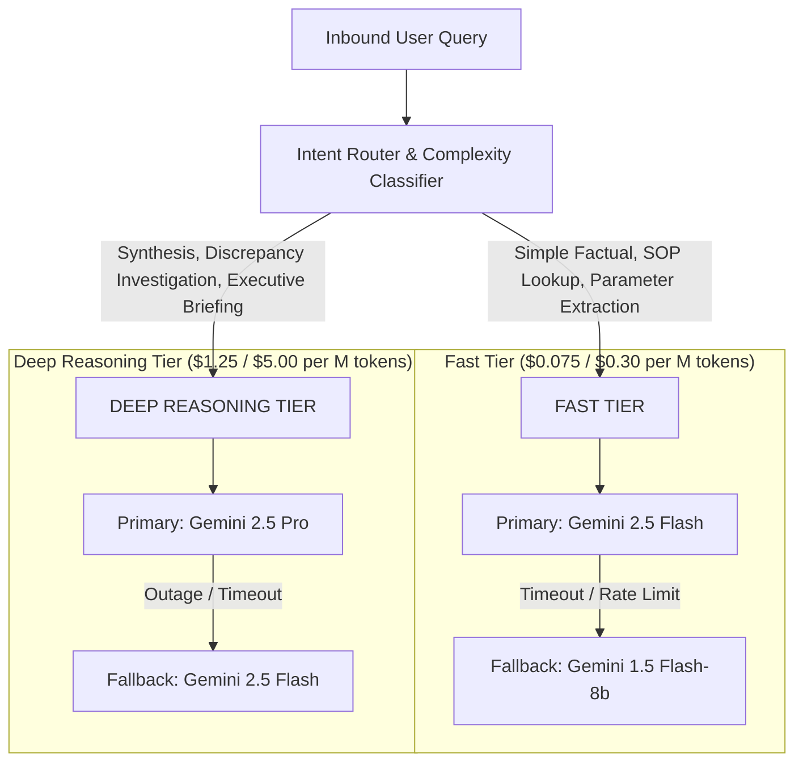

# Jarvis v1 — Dynamic Model Routing Specification
**Phase 5: Evaluation, Reliability & Optimization**  
**Component Path:** `gateway/src/orchestrator/model_router.ts`  
**Configuration File:** `gateway/src/config/models_registry.yaml`  
**Author:** Principal AI Systems Engineer  
**Date:** 2026-11-06  

---

## 1. Architectural Philosophy & Capability Separation

To achieve enterprise cost efficiency without compromising precision, Jarvis v1 strictly separates tasks into **Two Performance Tiers**:
1. **Deterministic Calculations NEVER Run on LLMs**: All financial arithmetic, FIFO layers, margin percentages, and package counts execute via deterministic SQL in the Phase 1 Metrics Engine.
2. **Intent-Driven Routing**: LLM queries dynamically evaluate task complexity, intent classification, and token budget limits before selecting a model tier.

---

## 2. Routing Tiers Specification

### A. FAST TIER
- **Primary Model:** `gemini-2.5-flash` (Input: $0.075/M, Output: $0.30/M)
- **Fallback Model:** `gemini-1.5-flash-8b` (Input: $0.0375/M, Output: $0.15/M)
- **Timeout SLA:** 10,000 ms
- **Workloads:**
  - Standard SOP and knowledge retrieval (`sop-receiving.md`, `partner-terms.md`)
  - Intent classification and tool argument extraction
  - Single-turn factual answers

### B. DEEP REASONING TIER
- **Primary Model:** `gemini-2.5-pro` (Input: $1.25/M, Output: $5.00/M)
- **Fallback Model:** `gemini-2.5-flash` (Input: $0.075/M, Output: $0.30/M)
- **Timeout SLA:** 30,000 ms
- **Workloads:**
  - Multi-step reconciliation (FIFO vs. operational gross margins)
  - Executive daily briefings and strategic risk synthesis
  - Complex root-cause investigations across warehouse nodes

---

## 3. Provider Fallback & Health Tracking

- Fallback execution triggers on HTTP 429 (Rate Limit), 503/504 (Provider Outage), or request timeout.
- The system logs a structured warning and updates provider health metrics in `jarvis_system.audit_logs`.
- **Silent Downgrade Guard:** If a fallback model lacks the necessary reasoning context or tool-calling schema, the request fails safely with an explicit error rather than hallucinating.
