# Jarvis v1: Technical System Architecture (Enterprise Edition)
**Unified Intelligence Platform for Meridian Supply Chain (MSC)**
*Author: Principal Software Architect, Senior AI Engineer & Technical Documentation Specialist*
*Target Infrastructure: Modest Linux EU Application Host (Hetzner Cloud fsn1) + Supabase Managed PostgreSQL 16 (EU Central / Frankfurt)*
*Source Systems: AWS RDS us-east-1 (PostgreSQL: seller_db, wms_db, portal_db), QuickBooks Online, Team AI Workspaces, Slack*
*Date: October 2026*
*Document Status: Certified & Hardened Architectural Blueprint*

---

## 1. Fundamental Architectural Principle

> **Jarvis is an intelligence layer over Meridian's existing business systems, not a replacement ERP or business management system.**

Meridian Supply Chain (MSC) operates three core transactional systems:
1. `seller_db` (Django / PostgreSQL): Transactional platform for 6,000 independent sellers, buy lists, and cashout disbursements.
2. `wms_db` (Ruby on Rails / PostgreSQL): Operational warehouse management system across East (EWR1) and West (ONT1) fulfillment hubs.
3. `portal_db` (Next.js / PostgreSQL): Wholesale buyer portal for 400 B2B partners, dynamic quoting, orders, and public market index.

Jarvis does **not** replace the Django seller platform, Rails WMS, or Next.js portal. It neither writes primary financial ledger entries nor directly modifies operational warehouse bin allocations. Instead, Jarvis serves as an **authoritative, read-only intelligence layer with a human-confirmed action boundary** that:
- Unifies disparate operational data across unshared keys into a canonical crosswalk.
- Enforces certified mathematical metrics for corporate KPIs via a pre-compiled Metrics Registry.
- Dispatches proactive alerts before operational or credit crises escalate.
- Provides semantic context and institutional memory to 25 teammates across all AI interfaces.
- Triggers approved operational workflows strictly via a **Restricted Action Service** requiring human confirmation.

### Core Architectural Invariants
1. **Numbers from SQL, Context from Documents**: Business numbers (revenue, margins, package counts, credit balances) come exclusively from live systems via pre-compiled SQL in a curated Metrics Registry against the Supabase Analytics Schema. Vector memory stores zero numbers.
2. **Zero Direct Database Write Access for LLMs**: The AI model possesses no database write privileges whatsoever. Any operational action (e.g., placing a credit hold on Northgate) must traverse the **Restricted Action Service** with human approval, scoped API credentials, and unique idempotency keys.
3. **Identity Propagation & Per-User Scoping**: Every incoming query is bound to an authenticated Meridian employee email (`firstname@meridiansc.com`). Multi-layered authorization (Gateway RBAC, Tool Scopes, Supabase Database Roles, and Row-Level Security) prevents horizontal or vertical data leakage.
4. **Physically Isolated Sensitive Data**: Full bank account numbers, member payment credentials, and raw employee payroll tables are excluded from replication to the analytics host.
5. **Modern MCP Protocol Standards**: Uses official Model Context Protocol (MCP) transports: `stdio` for local tools and **Streamable HTTP** for remote clients, eliminating deprecated HTTP+SSE transports.

---

## 2. Information Trajectory: The End-to-End Request Journey

Information flows through a single, strictly governed path:

```
Employee (Slack / MCP Client / Admin Panel)
   │
   ▼
[1. User Interaction Layer]
   │  (Transports: Slack Socket Mode / MCP stdio / Streamable HTTP with Bearer Auth)
   ▼
[2. Gateway Layer: Fastify Orchestrator]
   │  (Identity Resolution, Role Binding, Input Sanitization, Rate Limiting, Audit Logging)
   ▼
[3. Intent Router & Tool Selector]
   │  (Classifies Query: Metric, Document Knowledge, Proactive Alert, Action, or Dual Synthesis)
   ├────────────────────────┬────────────────────────┬────────────────────────┐
   ▼                        ▼                        ▼                        ▼
[4. Metrics Engine] [5. Alert Engine]       [6. Memory & Retrieval]  [7. Restricted Action Service]
   │ (Pre-compiled SQL)    │ (Deterministic Rules)  │ (Dense + Sparse RRF)   │ (Human Confirmation Required)
   ▼                        ▼                        ▼                        ▼
[Analytics Schema]   [Rules Evaluator]       [pgvector Memory]        [Restricted Business API]
   │ (Supabase EU)          │ (Pre-computed triggers)│ (Supabase EU)          │ (Idempotency Key & Scopes)
   ▲                        │                        ▲                        ▼
   │ Sources: seller_db,    │                        │ Sources: Notes, Drive, [Downstream System]
   │ wms_db, portal_db, QBO │                        │ Session Candidates     │ (e.g. Portal Credit Hold)
   └────────────────────────┴────────────────────────┴────────────────────────┘
                                   │
                                   ▼
                    [8. Configurable Model Router]
                       (Claude 3.5 Sonnet / Haiku / GPT-4o-mini via models_registry.yaml)
                       (Token spend caps, composite authorization-aware caching)
                                   │
                                   ▼
                    [9. Structured Response with Evidence]
                       (Exact numbers from SQL + Markdown citations + Action confirmation)
```

---

## 3. The 12 Architectural Layers

### Layer 1: User Interaction Layer
Provides client connectivity across all existing employee tools:
- **Slack Bot (`@jarvis`)**: Primary conversational interface in company channels and private DMs, operating via Slack Socket Mode (avoiding inbound public webhook exposure).
- **Model Context Protocol (MCP) Clients**: Official MCP connectors for Claude Desktop, Claude Code, Cursor IDE, Codex, and Gemini CLI. Uses `stdio` for local environments and **Streamable HTTP** for remote connections.
- **Jarvis Admin Dashboard**: Web management portal for team leads and administrators to manage users, tokens, AI spend, memory candidate approvals, and system health.

### Layer 2: MCP and API Gateway
Single network edge running as a Node.js/Fastify service on the Hetzner EU host:
- Supports `stdio` transport and **Streamable HTTP** (`/mcp/stream`) with HTTP Bearer authentication.
- Enforces IP and token-based rate limiting (120 requests/minute per token; burst up to 30).
- Validates all inbound payloads using strongly-typed Zod schemas.

### Layer 3: Authentication and Authorization Layer
- Resolves client-specific identity tokens to Meridian corporate email (`firstname@meridiansc.com`).
- Enforces Role-Based Access Control (RBAC) across 8 discrete roles (Founder, Ops, Finance, Sales, Warehouse, Support, Engineering, Admin).
- Injects an immutable `UserSecurityContext` into downstream tool executions.

### Layer 4: AI Orchestration and Intent Router
- Single orchestrator architecture utilizing LLM function calling (OpenAI / Anthropic tool use specification).
- Employs zero-shot prompt routing to classify user queries into five execution branches:
  1. `Metric Query`: Invokes `execute_metric()` from the registry.
  2. `Document Query`: Invokes `search_company_knowledge()` over pgvector memory.
  3. `Alert / Incident Query`: Invokes `get_active_alerts()`.
  4. `Action Request`: Invokes `request_action_execution()` (requires human confirmation).
  5. `Dual Synthesis`: Queries metrics first, enriches with document citations.

### Layer 5: Business Metrics Engine
- Central repository of pre-compiled, parameterized SQL queries (`metrics_registry.yaml`).
- Enforces dynamic IANA timezone casting (`America/New_York` for East, `America/Los_Angeles` for West) directly in PostgreSQL via `AT TIME ZONE`.
- Governs data freshness watermarks (`data_as_of: 2026-10-20T13:30:00Z`).

### Layer 6: Proactive Alert Engine & Notification Adapters
- Background daemon powered by BullMQ on Redis 7.
- Executes deterministic threshold monitors:
  - *ACH Payout Failures*: Detects `status = 'failed'` or `on_hold > 24h`.
  - *Partner Credit Breaches*: Detects `open_ar > credit_limit`.
  - *Inventory Cost Inversions*: Detects `market_spot_price < fifo_unit_cost`.
- Employs a decoupled **Notification Adapter** routing structured alert events to Slack Block Kit, Admin Panel, or email.

### Layer 7: Shared Company Memory and RAG
- Hosted on Supabase utilizing the native `pgvector` extension.
- Employs Hybrid Retrieval combining dense vector embeddings (1536-dim via `text-embedding-3-small`) with sparse keyword matching (`tsvector` with BM25-equivalent ranking) merged via Reciprocal Rank Fusion (RRF).
- Enforces cross-encoder reranking to deliver the top-5 most relevant chunks with file and line-level citations.

### Layer 8: Unified Analytics Database (Supabase EU Central)
- High-performance Managed PostgreSQL 16 database hosted on **Supabase** in AWS EU Central (Frankfurt).
- Star schema containing unified dimensions (`dim_members`, `dim_partners`, `dim_products`, `dim_warehouses`, `dim_product_crosswalk`) and fact tables (`fact_dock_receipts`, `fact_orders`, `fact_invoices`, `fact_payouts`, `fact_cost_layers`).
- Structurally excludes sensitive columns (bank accounts, routing numbers, raw salaries).

### Layer 9: PostgreSQL + pgvector Memory Store (Supabase)
- Partitioned vector tables separating public company documentation (`knowledge_public`), department-scoped procedures (`knowledge_dept`), and user-private session notes (`knowledge_private`).
- Enforces knowledge staging: AI session extracts are staged as candidates and require human owner approval or multi-session corroboration before promotion to global memory.

### Layer 10: Canonical Product Crosswalk & Identity Resolution
- Canonical product crosswalk reconciling WMS items, Portal products, UPC barcodes, and manufacturer codes with explicit mapping sources and confidence scores.
- Member and partner resolution requiring exact verified identifiers or multi-attribute matching (confidence >= 0.95), strictly avoiding naive domain-based merging.

### Layer 11: Primary Data Synchronization Layer
- Scheduled CDC / incremental extraction worker querying AWS RDS read replicas over a secure connection.
- 15-minute incremental sync frequency using `updated_at` checkpoints and retry queues; nightly full reconciliation detecting deletions and layer adjustments.
- Treats the three source databases as physically separate systems consolidated only within the Supabase analytics schema.

### Layer 12: Restricted Action Service
- Strictly isolated service layer managing authorized business workflows.
- Operates with dedicated, narrowly scoped API credentials to downstream business systems.
- Mandates explicit human confirmation, generates unique idempotency keys, and writes immutable audit ledger records.

---

## 4. The 12 Comprehensive Architectural Diagrams (Mermaid)

### Diagram 1: High-Level System Architecture
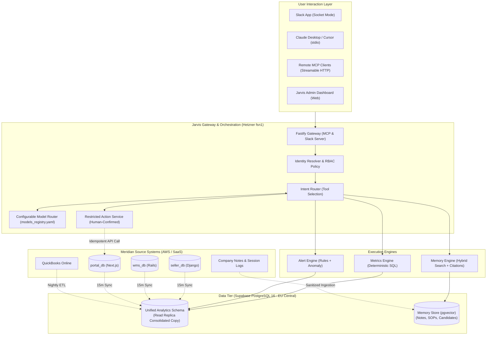

---

### Diagram 2: Detailed Component Architecture
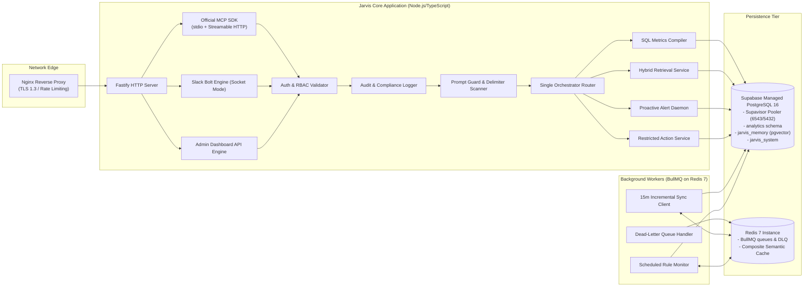

---

### Diagram 3: End-to-End Request Lifecycle
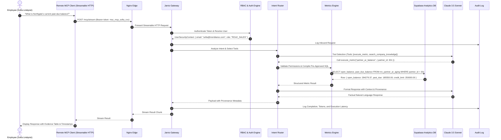

---

### Diagram 4: Live Business Intelligence Pipeline
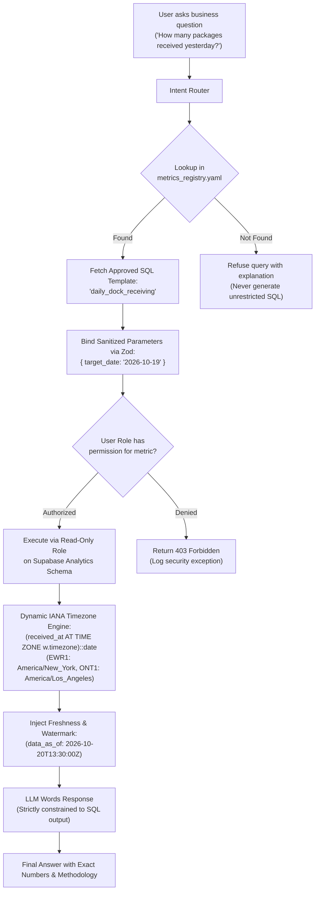

---

### Diagram 5: RAG Ingestion and Retrieval Pipeline
```mermaid
flowchart TD
    subgraph Ingestion_Stage["Ingestion Pipeline (Asynchronous / Nightly)"]
        RawDocs["Company Notes, SOPs, Policies
(from notes/ directory)"] --> Redactor["PII & Sensitive Redactor
(SSN, Salaries, Full Bank Accounts)"]
        Redactor --> FilterPrivate{"Belongs to
founder_private?"}
        FilterPrivate -->|Yes| Drop["Exclude from Shared Index"]
        FilterPrivate -->|No| Chunker["Semantic Markdown Chunker
(512 tokens + 10% overlap)"]
        Chunker --> Embedder["Generate Embeddings
(text-embedding-3-small)"]
        Embedder --> VectorInsert["Insert into Supabase pgvector with HNSW index"]
        Chunker --> TextIndex["Generate tsvector for GIN Full-Text Search"]
    end

    subgraph Query_Stage["Retrieval Pipeline (Runtime <300ms)"]
        Query["User Question ('What are Gold partner terms?')"] --> EmbedQuery["Embed Query Vector"]
        Query --> TokenizeText["Parse Keyword Terms"]
        EmbedQuery --> DenseSearch["Dense Cosine Search (pgvector HNSW)"]
        TokenizeText --> SparseSearch["Sparse Full-Text Search (GIN BM25)"]
        DenseSearch --> RRF["Reciprocal Rank Fusion (RRF Scoring)"]
        SparseSearch --> RRF
        RRF --> Rerank["Cross-Encoder Top-5 Reranking"]
        Rerank --> ContextAssembly["Assemble Grounded Prompt Context
with Document Path & Section Headers"]
    end
```

---

### Diagram 6: AI Session Memory Ingestion Lifecycle
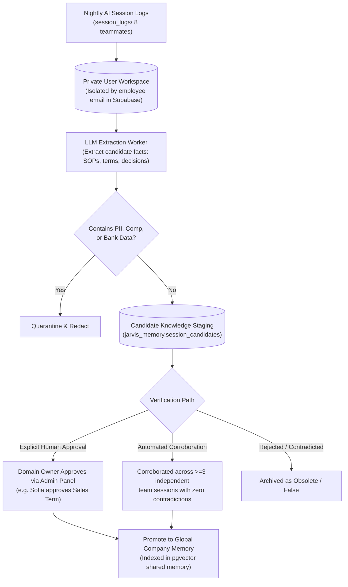

---

### Diagram 7: Proactive Monitoring and Alert Pipeline
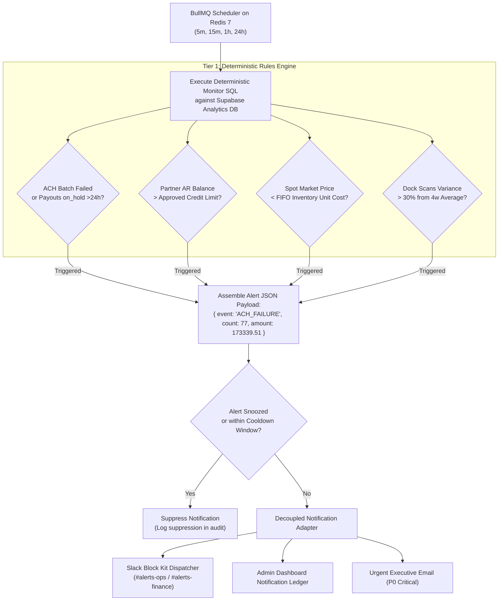

---

### Diagram 8: Canonical Crosswalk & Identity Resolution Architecture
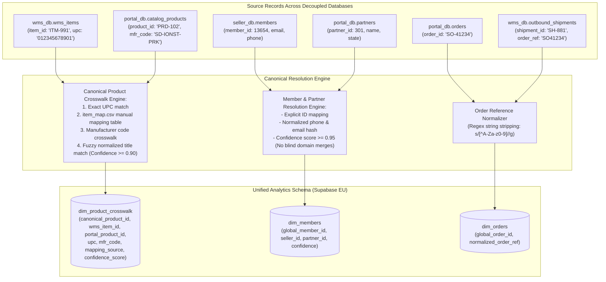

---

### Diagram 9: Database Entity-Relationship (ER) Architecture
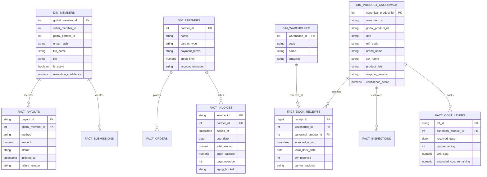

---

### Diagram 10: Multi-Tier Security, Authorization and Action Boundary Flow
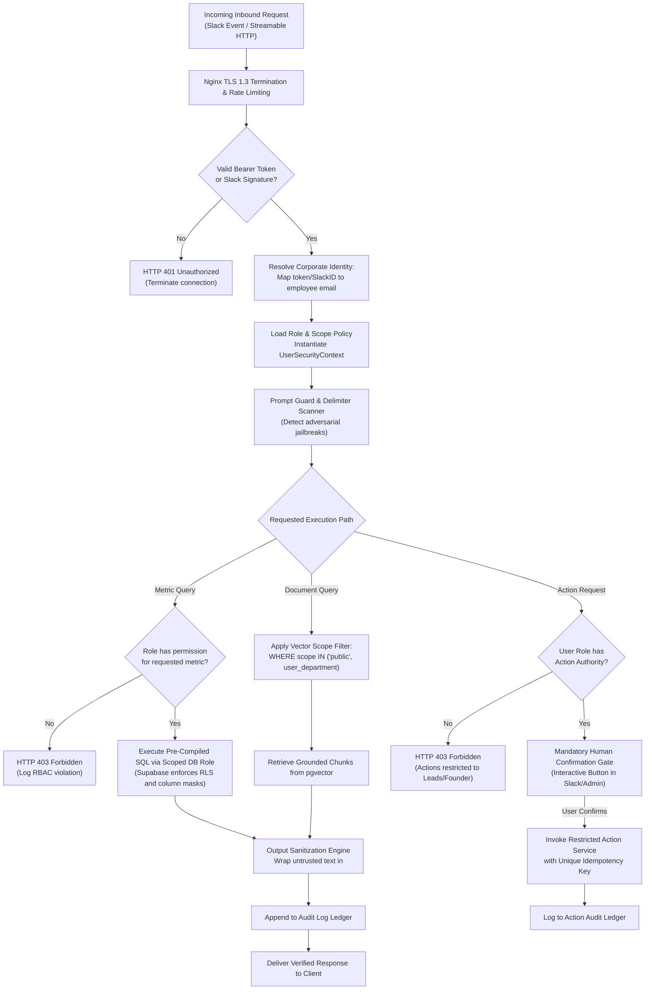

---

### Diagram 11: Production Deployment Architecture (Modular Monolith on Hetzner + Supabase)
```mermaid
flowchart TD
    subgraph Host["Hetzner Dedicated Application Host (fsn1 - Ubuntu 24.04 LTS)"]
        UFW["Linux Kernel Firewall (UFW: 22, 80, 443 only)"]
        
        subgraph DockerNetwork["Docker Bridge Network (Internal only)"]
            Nginx["proxy: Nginx 1.25
- Ports: 80, 443
- Let's Encrypt TLS 1.3
- Rate Limit: 120r/m"]
            
            Gateway["jarvis-gateway: Node.js 20
- Streamable HTTP MCP Server
- Slack Bolt Daemon
- Admin Dashboard API
- Intent Router"]
            
            Workers["jarvis-workers: Node.js 20
- BullMQ Scheduler on Redis 7
- Proactive Alert Daemon
- 15m Incremental Sync Client
- Dead-Letter Queue (DLQ) Handler"]
            
            Redis[("jarvis-redis: Redis 7.2
- BullMQ Job Queues
- Composite Semantic Cache")]
        end

        LogicalBackupCron["Nightly Logical Backup Cron
(pg_dump export to S3)"]
    end

    subgraph Supabase_Cloud["Supabase Managed Database (EU Central - Frankfurt)"]
        Supabase_PG[("Supabase PostgreSQL 16 + pgvector
- Supavisor Connection Pooler (6543/5432)
- analytics schema
- jarvis_memory schema
- jarvis_system schema
- Automated Daily & PITR Backups")]
    end

    subgraph AWS_Cloud["AWS Infrastructure (us-east-1)"]
        RDS_Replica[("AWS RDS PostgreSQL Read Replica
(Source Databases: seller, wms, portal)")]
    end

    subgraph Offsite_Storage["Offsite Encrypted Backup Storage"]
        S3Bucket["AWS S3 / Cloudflare R2
(Encrypted Logical Dumps)"]
    end

    subgraph Observability["External Monitoring & Sinks"]
        UptimeMonitor["External Uptime Monitor (Better Uptime)"]
        SlackCloud["Slack Cloud Infrastructure"]
    end

    Nginx --> Gateway
    Gateway --> Redis
    Workers --> Redis
    Gateway -->|TLS Pooler (Port 6543)| Supabase_PG
    Workers -->|Direct TLS (Port 5432)| Supabase_PG
    Workers <-->|15m Sync Stream| RDS_Replica
    LogicalBackupCron -->|Logical Dump| Supabase_PG
    LogicalBackupCron -->|Encrypted Upload| S3Bucket
    UptimeMonitor -.->|60s HTTPS Health Ping| Nginx
    SlackCloud <-->|WSS (Socket Mode)| Gateway
```

---

### Diagram 12: Complete Corporate Data Flow Diagram
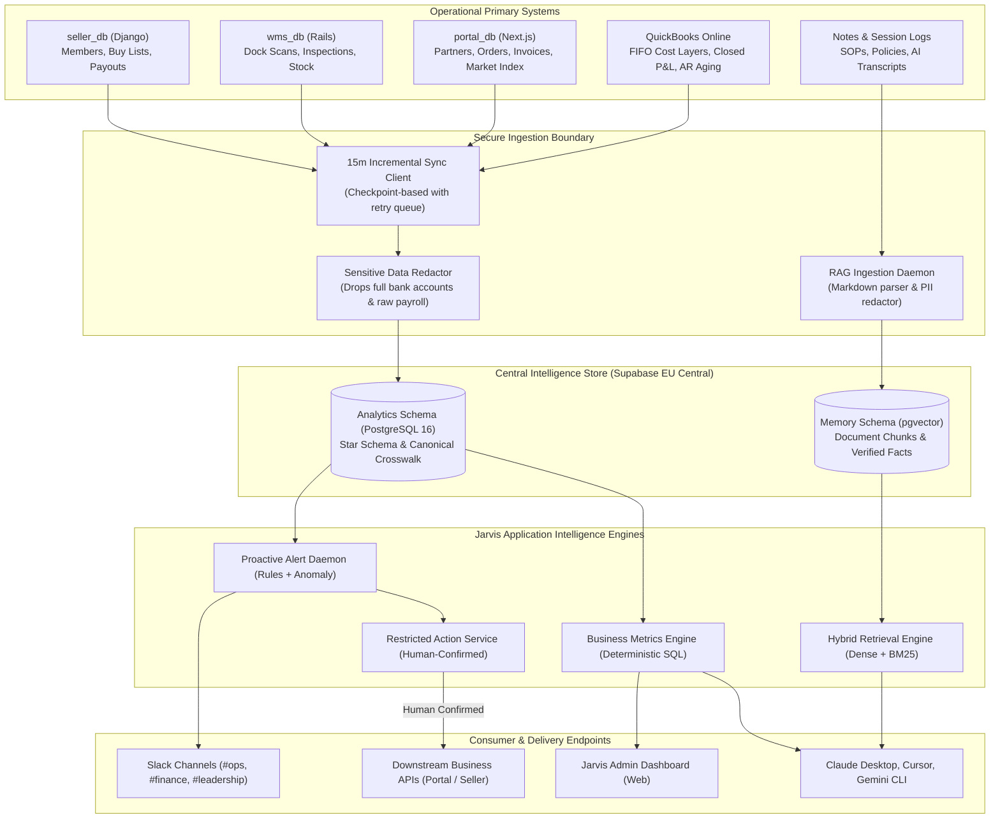

---

## 5. Database Architecture & Canonical Crosswalk

### Source Database Topologies (AWS RDS us-east-1)
1. **`seller_db` (10 Tables)**: Manages 6,000 member sellers, buy lists, pre-quotes, sell submissions, payouts, and support tickets.
2. **`wms_db` (9 Tables)**: Manages fulfillment warehouses (EWR1, ONT1), package receipts, condition inspections, stock levels, and outbound shipments.
3. **`portal_db` (16 Tables)**: Manages 400 wholesale partners, catalog products, quotes, orders, invoices, payments, and market price index.

### The Canonical Product Crosswalk (`dim_product_crosswalk`)
Resolves the schema semantic mismatch between retail barcodes (`upc`) and manufacturer SKUs (`mfr_code`):
```sql
CREATE TABLE analytics.dim_product_crosswalk (
    canonical_product_id SERIAL PRIMARY KEY,
    wms_item_id TEXT UNIQUE,
    portal_product_id TEXT,
    upc VARCHAR(14),
    mfr_code TEXT,
    brand_name TEXT NOT NULL,
    set_name TEXT NOT NULL,
    product_title TEXT NOT NULL,
    mapping_source TEXT CHECK (mapping_source IN ('UPC_EXACT', 'MAPPING_FILE', 'MANUAL_VERIFIED', 'FUZZY_STRING')),
    confidence_score NUMERIC(4,3) NOT NULL,
    verified_by TEXT,
    verified_at TIMESTAMPTZ
);
```

### Dynamic IANA Timezone Normalization
Avoids brittle hardcoded EDT/PDT offsets. All SQL metric templates execute timezone conversion natively:
```sql
SELECT 
    w.code AS warehouse_code,
    (p.received_at AT TIME ZONE w.timezone)::date AS dock_local_date,
    COUNT(*) AS packages_received
FROM analytics.fact_dock_receipts p
JOIN analytics.dim_warehouses w ON p.warehouse_id = w.warehouse_id
WHERE (p.received_at AT TIME ZONE w.timezone)::date = :target_date
GROUP BY 1, 2;
```

---

## 6. AI Architecture, Routing & Modern MCP Transport

### Single Orchestrator Architecture
Jarvis v1 deliberately rejects complex multi-agent architectures (e.g., AutoGen, CrewAI) in favor of a **Single Deterministic Orchestrator**. A modular single orchestrator with strict function-calling schemas delivers sub-3-second responses at 10x lower operational cost.

### Modern MCP Protocol Standards
In compliance with the official Model Context Protocol specification:
- **`stdio`**: Transport for local desktop CLI tools (Claude Desktop local process, Cursor local extension).
- **`Streamable HTTP`**: Modern standard remote transport providing persistent streaming connections (`POST /mcp/stream`) over HTTP, replacing legacy deprecated SSE transports.

### Authorization-Aware Composite Semantic Caching
To prevent cross-user data leakage and ensure financial exactness, cache keys are computed as a multi-attribute composite hash:
```typescript
cacheKey = SHA256(
  normalizedQuery + "|" +
  JSON.stringify(sanitizedParameters) + "|" +
  userSecurityContext.role + "|" +
  userSecurityContext.allowedScopes.sort().join(",") + "|" +
  currentETLWatermarkTimestamp
);
```
- **Financial Metrics**: Require **exact parameter match** (no fuzzy semantic reuse) and short TTL (15m).
- **General SOPs**: Utilize semantic matching with high similarity threshold $\ge 0.98$.
- **Cache Invalidation**: Entire cache is purged upon completion of every 15-minute ETL synchronization.

---

## 7. Technology Selection and Justification

| Technology | Selection | Evaluated Alternatives | Architectural Rationale & Trade-off |
|---|---|---|---|
| **Core Runtime** | **Node.js 20 LTS / TypeScript** | Python (FastAPI), Go | High-throughput asynchronous I/O; official TypeScript SDKs for Model Context Protocol (MCP) and Slack Bolt; shared type definitions across gateway, workers, and tools. |
| **Relational & Vector Store** | **Supabase Managed PostgreSQL 16 + pgvector** | Self-hosted PostgreSQL on VM, Pinecone, Qdrant | Managed high-availability PostgreSQL with native `pgvector`, built-in connection pooling (Supavisor), automated point-in-time recovery (PITR), Row-Level Security (RLS), and web dashboard. Hosted in EU Central (Frankfurt) for GDPR data residency with zero server maintenance overhead. |
| **Database Access** | **Prisma / Kysely** | Raw SQL strings, TypeORM | Provides compile-time type safety, automated migrations, and zero overhead for complex analytical SQL compilation. |
| **Protocol Layer** | **Model Context Protocol (MCP)** | Custom REST APIs, GraphQL | Open industry standard supported natively by Claude Desktop, Claude Code, Cursor, and Codex; enables seamless drop-in integration without custom desktop plugins. Uses `stdio` and modern `Streamable HTTP`. |
| **Job Queue & Scheduling** | **Redis 7 + BullMQ** | RabbitMQ, Celery, pg_boss | Dedicated, ultra-fast memory footprint (<50MB); robust scheduling, retries, exponential backoff, dead-letter queues (DLQ), and distributed job locking. |
| **Containerization** | **Docker Compose** | Kubernetes, AWS ECS | Zero control-plane overhead; entire modular monolith runs predictably on a single modest Linux server ($40/month); trivial disaster recovery and local replication. |
| **Edge Proxy** | **Nginx 1.25** | Traefik, Caddy | Proven battle-tested performance; robust rate limiting; SSL termination via Certbot; native request buffering and security headers. |

---

## 8. Architectural Trade-Off Analysis

### 1. Structured SQL vs. Vector RAG for Business Metrics
- **Decision**: All operational and financial metrics originate **strictly from SQL** against the analytics database.
- **Comparison**:
  - *Vector RAG for Numbers*: Prone to stale data, hallucinated calculations, and temporal blindness. In Jarvis v0, this led to reporting net-90 credit terms and outdated unit costs.
  - *Deterministic SQL*: Mathematically exact, verifiable against primary ledgers, respects timezone casting, and adheres to GAAP accounting.

### 2. Managed Supabase vs. Self-Hosted PostgreSQL on VM
- **Decision**: Host analytics and memory on **Supabase Managed PostgreSQL (EU Central)**.
- **Comparison**:
  - *Self-Hosted on VM*: High operational burden (managing physical disk growth, WAL archiving via WAL-G, replica failures, memory contention on modest host).
  - *Supabase Managed*: Automated daily backups + PITR, built-in Supavisor connection pooling, native pgvector support, and zero host database maintenance overhead.

### 3. Read-Only Intelligence vs. Uncontrolled AI Action Execution
- **Decision**: Enforce a strict **Restricted Action Service** requiring explicit human confirmation.
- **Comparison**:
  - *Autonomous Agent Actions*: High risk of erroneous financial transfers or unauthorized customer credit terms.
  - *Human-Confirmed Action Boundary*: Preserves least-privilege security while allowing Jarvis to initiate approved operational workflows seamlessly.

### 4. Modular Monolith vs. Microservices Architecture
- **Decision**: Deploy Jarvis v1 as a **Modular Monolith** in Docker Compose on a single dedicated Hetzner host.
- **Comparison**:
  - *Microservices*: Introduces unnecessary network serialization overhead, distributed tracing complexity, multiple failure points, and high cloud hosting costs ($500+/month).
  - *Modular Monolith*: Extremely fast in-memory communication between orchestrator and engines; single-server deployment; lean infrastructure cost (~$50/month); perfectly matches a 25-person company scale.
