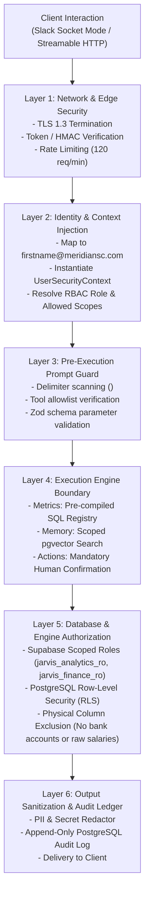
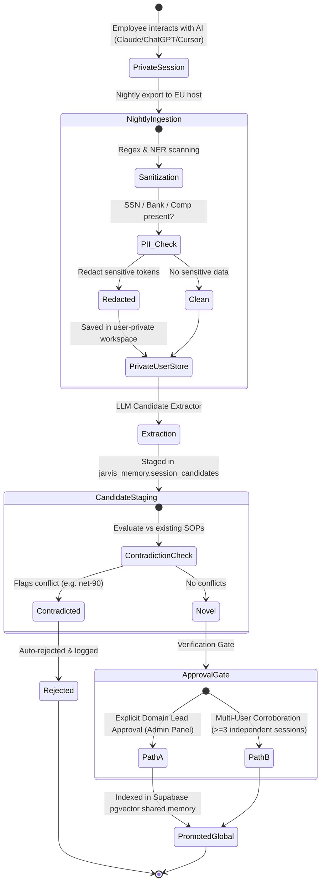

# Jarvis v1: Security, Authentication, and Authorization Specification (Enterprise Edition)
**Unified Intelligence Platform for Meridian Supply Chain (MSC)**
*Author: Principal Software Architect, Senior AI Engineer & Technical Documentation Specialist*
*Target Infrastructure: Modest Linux EU Application Host (Hetzner fsn1) + Supabase Managed PostgreSQL 16 (EU Central / Frankfurt)*
*Date: October 2026*
*Document Status: Certified Security Specification (Approved for Execution)*

---

## 1. Executive Security Context & Historical Incident Remediation

In Jarvis v0, security was an afterthought. The platform suffered from fundamental vulnerabilities that created severe compliance, legal, and operational risks:
1. **The Shared Superuser Vulnerability (`jarvis_svc`)**:
   - Jarvis v0 connected to all three production PostgreSQL databases (`seller_db`, `wms_db`, `portal_db`) using a single shared database user (`jarvis_svc`) possessing broad `SELECT` privileges on all tables.
   - When Finance Manager **Kenji Watanabe** tested Jarvis on September 3, 2026, by asking it to *"show payroll by person"*, the SQL tool executed the query directly against compensation records. The LLM refused to output the result only because of a soft system prompt instruction (*"don't answer comp questions"*). Had an indirect prompt injection succeeded, unmasked employee salaries would have leaked.
2. **Excessive API Write Privileges**:
   - In `jarvis_v0/config.yaml`, the system was configured with the unsegmented production API key `seller-integration-prod` from 1Password. This key possessed full write scopes: `members:read submissions:read submissions:write buylist:write payouts:write`. An advisory assistant possessed the latent technical ability to disburse member funds or corrupt buy list pricing!
3. **Anonymous Identity in MCP Connectors**:
   - The Claude Desktop MCP connector was shared across the team via a static URL pinned in Slack without per-user authentication. Any employee querying Jarvis via Claude Desktop was completely anonymous.
4. **Unverified Memory Ingestion & Poisoning**:
   - The nightly ingest script automatically extracted "durable facts" from unverified AI session logs with zero human review. This led directly to **memory poisoning**: on October 6, 2026, Jarvis instructed Sales Lead **Sofia Lindqvist** that Gold partners receive *net-90 payment terms* (a hallucinated entry `mem_00546`), directly contradicting company policy (*net-30 strictly enforced*).
5. **Primary Database Thread Exhaustion**:
   - Direct execution of analytical SQL by staff against production databases caused a 47-minute crash of the Wholesale Partner Portal on September 2, 2026.

### The Jarvis v1 Security Mandate
> **Access control must be enforced across a multi-layer defense-in-depth model — never solely by model prompting.**
> **Jarvis is strictly read-only at the database engine level. It possesses zero direct database write credentials.**
> **Operational workflows are executed strictly via a human-confirmed Restricted Action Service with idempotency keys.**

---

## 2. User Roles and Organizational Mapping

Meridian Supply Chain employs 25 individuals (18 staff employees, 7 independent contractors) across five core business functions. Jarvis v1 establishes 8 strictly governed Role-Based Access Control (RBAC) tiers.

| Role ID | Role Name | Authorized Meridian Teammates (from `roster.md`) | Employment Type | Security Scope & Data Boundary |
|---|---|---|---|---|
| **ROLE_FOUNDER** | Founder & CEO | **Sam Okafor** | Staff | Unrestricted access across all operational, financial, and strategic data; exclusive access to `founder_private/` scope; full action approval authority. |
| **ROLE_OPS** | Operations Lead & Coordinators | **Priya Raman** (Head of Ops), **Mei Tanaka** (Ops Coordinator) | Staff | Read-only access to warehouse dock receipts, cross-system identity crosswalks, inspection throughput, and member sell submissions. Can trigger dock queue alerts. |
| **ROLE_FINANCE** | Finance & Accounting | **Kenji Watanabe** (Finance Manager), **Lucia Moreno** (Bookkeeper) | Staff (Kenji), Contractor (Lucia) | GAAP P&L, AR aging, FIFO cost layers, invoice reconciliations, payment batch status. Raw payroll restricted to Kenji. Full payout batch approval authority. |
| **ROLE_SALES** | Wholesale Partner Sales | **Sofia Lindqvist** (Sales Lead), **Zoe Adams** (Pricing Analyst), **Chloe Martin** (Account Mgr), **Owen Brooks** (Account Mgr), **Isaac Green** (Market Content) | Staff (Sofia, Zoe, Chloe), Contractor (Owen, Isaac) | Portal catalog, wholesale quotes, orders, partner AR balances, credit limits, and market spot prices. Can request partner credit hold actions (Sofia). |
| **ROLE_WHSE** | Warehouse Floor & Inspection | **Marcus Bell** (East Mgr), **Dana Ortiz** (West Lead), **Tomas Rivera**, **Aisha Khan**, **Ben Carter**, **Grace Liu**, **Diego Santos**, **Nora Byrne**, **Ravi Patel** | Staff | Inbound packages, package line item counts, bin locations, outbound shipments. Strictly blocked from financial margins, partner terms, and credit data. |
| **ROLE_SUPPORT** | Member Support & Payouts | **Hannah Cole** (Lead), **Maya Singh**, **Ethan Wright** | Staff (Hannah), Contractor (Maya, Ethan) | Seller submissions, carrier tracking, payout statuses (`paid`, `pending`, `failed`, `on_hold`), support tickets. Bank details masked (last 4 only). |
| **ROLE_ENG** | Software Engineering | **Arjun Mehta** (Senior Backend), **Leo Fischer** (Integrations), **Felix Wagner** (Frontend) | Staff (Arjun), Contractor (Leo, Felix) | System health, database schema definitions, metrics registry code, API specifications, and error logs. |
| **ROLE_ADMIN** | System Administrator | Internal Security Service Daemon, Automated Backup Cron | Automated Service | Key rotation, user token provisioning, database migration execution, audit log maintenance. |

*Governance Note on Contractors*: Independent contractors (Lucia, Owen, Maya, Ethan, Leo, Felix, Isaac) are engaged via corporate contracts (`hr/contractor-guidelines.md`). Contractors are strictly prohibited from viewing executive meeting notes, founder-private documents, or company-wide compensation data.

---

## 3. Comprehensive Granular Permission Matrix

The following matrix defines resource access permissions across all corporate roles:
- **`FULL`**: Read, parameterize queries, and view unredacted data.
- **`MASKED`**: Read-only with automatic field-level masking (e.g., account last-4 only).
- **`RESTRICTED`**: Conditional access requiring specific Attribute-Based Access Control (ABAC) approval.
- **`NONE`**: Absolute hardware/database level block (HTTP 403 / SQL permission denied).

| Resource / Data Domain | Founder | Operations | Finance | Sales | Warehouse | Support | Engineering | Admin |
|---|---|---|---|---|---|---|---|---|
| **Company SOPs & Policies** | FULL | FULL | FULL | FULL | FULL | FULL | FULL | FULL |
| **Founder-Private Notes** (`founder_private/`) | **FULL** | NONE | NONE | NONE | NONE | NONE | NONE | NONE |
| **Closed GAAP P&L & COGS** | FULL | NONE | FULL | NONE | NONE | NONE | NONE | FULL |
| **Live Gross Trading Margin** | FULL | FULL | FULL | FULL (Quotes) | NONE | NONE | NONE | FULL |
| **Employee Payroll & Salaries** | FULL | NONE | **RESTRICTED** (Kenji only) | NONE | NONE | NONE | NONE | NONE |
| **Seller Banking & Payout Credentials** | FULL | NONE | MASKED (Last 4) | NONE | NONE | **MASKED** (Last 4) | NONE | NONE |
| **Seller Submissions & Buy Lists** | FULL | FULL | FULL | NONE | MASKED | FULL | FULL | FULL |
| **Partner Orders, Quotes & Terms** | FULL | FULL | FULL | FULL | NONE | NONE | FULL | FULL |
| **Partner AR Balances & Overdue Aging** | FULL | NONE | FULL | **FULL** | NONE | NONE | NONE | FULL |
| **Dock Receiving & Inbound Packages** | FULL | FULL | FULL | NONE | **FULL** | FULL | FULL | FULL |
| **Warehouse Stock Levels & Bins** | FULL | FULL | FULL | FULL | **FULL** | NONE | FULL | FULL |
| **Private AI Session Logs** | FULL (Own) | FULL (Own) | FULL (Own) | FULL (Own) | FULL (Own) | FULL (Own) | FULL (Own) | NONE |
| **Global Promoted Memory Facts** | FULL | FULL | FULL | FULL | FULL | FULL | FULL | FULL |
| **Action: Place Partner Credit Hold** | **FULL** | NONE | FULL | **FULL** (Sofia) | NONE | NONE | NONE | NONE |
| **Action: Release Held Payout Batch** | **FULL** | NONE | **FULL** (Kenji) | NONE | NONE | **FULL** (Hannah) | NONE | NONE |
| **Action: Snooze Operational Alert** | FULL | FULL | FULL | FULL | NONE | NONE | FULL | FULL |
| **Audit Logs & Token Ledger** | FULL | NONE | FULL (Cost) | NONE | NONE | NONE | FULL | FULL |

---

## 4. Multi-Layer Defense-in-Depth Security Architecture



### 1. Transport & Edge Security
- Nginx edge proxy enforcing TLS 1.3 encryption.
- Modern Model Context Protocol (MCP) transports: `stdio` (local process) and **Streamable HTTP** (`/mcp/stream`) with HTTP Bearer token authentication.
- Deprecated HTTP+SSE transport eliminated.
- Rate limiting: 120 requests/minute per authenticated token.

### 2. Client Authentication & Identity Resolution
- **Slack App**: Connects exclusively via Slack Socket Mode. Resolves caller's Slack User ID to corporate email (`firstname@meridiansc.com`) via `users.info`.
- **MCP Clients (Claude Desktop, Cursor, Codex, Gemini CLI)**: Require personalized HTTP Bearer Token (`Authorization: Bearer msc_mcp_<user>_<hash>`). Shared or anonymous tokens are strictly blocked.
- Instantiates an immutable `UserSecurityContext`:
  ```typescript
  interface UserSecurityContext {
    userId: string;
    email: string; // e.g. "kenji@meridiansc.com"
    name: string; // e.g. "Kenji Watanabe"
    role: "ROLE_FOUNDER" | "ROLE_OPS" | "ROLE_FINANCE" | "ROLE_SALES" | "ROLE_WHSE" | "ROLE_SUPPORT" | "ROLE_ENG" | "ROLE_ADMIN";
    department: "leadership" | "operations" | "finance" | "sales" | "warehouse" | "support" | "engineering";
    isContractor: boolean;
    allowedScopes: string[];
    sessionStartedAt: Date;
  }
  ```

### 3. Multi-Layer Database Authorization & Supabase RLS
To prevent prompt injection bypasses, security is enforced **directly within the Supabase PostgreSQL engine** (EU Central):
1. **Dedicated Database Roles**:
   - `jarvis_analytics_ro`: Read-only access to standard dimension and dock receipt fact tables.
   - `jarvis_finance_ro`: Read-only access to financial views (`mv_partner_ar_aging`, `fact_invoices`).
   - `jarvis_ops_ro`: Read-only access to dock scans, inspections, and inventory bins.
2. **Supabase Row-Level Security (RLS) Policies**:
   - RLS policies applied to `jarvis_memory.document_chunks`:
     ```sql
     CREATE POLICY memory_department_isolation ON jarvis_memory.document_chunks
     FOR SELECT
     USING (
         scope = 'public' OR 
         scope = current_setting('request.jwt.claim.department', true) OR
         current_setting('request.jwt.claim.role', true) = 'ROLE_FOUNDER'
     );
     ```
3. **Physical Column Exclusions**:
   - The ETL pipeline structurally excludes `seller_db.payout_methods.ach_account_number` and `ach_routing_number`. These columns **do not exist** in the Supabase Analytics Database.
   - Raw Gusto payroll files (`payroll_summary.csv`) are strictly quarantined outside the database. Financial summaries in `analytics` expose only anonymized, departmental aggregates.

---

## 5. The Restricted Action Service: Human Confirmation Boundary

To reconcile the security mandate (*zero direct write access for AI*) with operational necessity (*ability to place credit holds or release payout batches*), Jarvis v1 implements the **Restricted Action Service**:

```mermaid
sequenceDiagram
    autonumber
    actor User as Sales Lead (Sofia Lindqvist)
    participant Chat as Slack / MCP Client
    participant GW as Jarvis Gateway
    participant ActionSvc as Restricted Action Service
    participant TargetAPI as Partner Portal API
    participant Audit as Action Audit Ledger

    User->>Chat: "Place Northgate Hobby on credit hold due to past-due AR."
    Chat->>GW: Dispatch Request (UserSecurityContext: ROLE_SALES)
    GW->>GW: Validate RBAC: Does Sofia have ACTION_CREDIT_HOLD scope? (YES)
    GW-->>Chat: Present Explicit Confirmation Dialog:
"Place Northgate Hobby (ID: 301) on Credit Hold?
• Open AR: $284,279.37
• Past-Due: $185,550.00
[Confirm Action] [Cancel]"
    User->>Chat: Clicks [Confirm Action]
    Chat->>GW: Deliver Confirmation with Signature Token
    GW->>ActionSvc: Execute Action (Action: CREDIT_HOLD, PartnerId: 301, IdempKey: idemp_99182)
    ActionSvc->>TargetAPI: PATCH /api/v1/partners/301/credit-hold (Header: X-Idempotency-Key)
    TargetAPI-->>ActionSvc: HTTP 200 OK (credit_hold: true)
    ActionSvc->>Audit: Log to jarvis_system.action_audit_ledger
    ActionSvc-->>Chat: "Action Complete: Northgate Hobby is now on credit hold. Confirmation: idemp_99182."
```

### Action Governance Rules:
1. **Zero LLM Direct DB Writes**: The LLM cannot execute `UPDATE` or `INSERT` queries against production databases.
2. **Explicit Human Confirmation**: Every write action requires an explicit interactive confirmation click (`[Confirm]`) by an authorized human lead.
3. **Strict Idempotency Keys**: Every action payload carries an `X-Idempotency-Key` (UUIDv4) preventing duplicate execution upon network retries or repeated button clicks.
4. **Immutable Action Audit Ledger**: Every action execution logs the initiating user email, confirming user email, exact parameter payload, downstream API response, and timestamp.

---

## 6. AI Session Memory Isolation and Knowledge Staging

A major vulnerability in Jarvis v0 was the automatic, unverified appending of daily AI session logs into global memory. Jarvis v1 establishes a strictly governed, multi-stage memory promotion lifecycle.



---

## 7. Enterprise Threat Model & Attack Mitigations

| Threat ID | Attack Vector | Severity | Concrete Technical Mitigation in Jarvis v1 |
|---|---|---|---|
| **THREAT-01** | **Direct & Indirect Prompt Injection** (e.g., hidden instructions in member support tickets or notes) | High | Multi-layered defense: Text wrapped in `<untrusted_data>`; strict tool allowlisting; input parameter validation via Zod; strict output JSON schemas; system prompt directed to treat retrieved data as passive text. |
| **THREAT-02** | **Unauthorized SQL Execution** (SQL injection via LLM parameter generation) | Critical | The LLM **never writes SQL**. It only selects approved metric IDs from `metrics_registry.yaml`. Parameters are strongly typed and sanitized using Zod schemas before being bound via parameterized prepared statements. |
| **THREAT-03** | **Cross-User Data Leakage** (Warehouse staff querying executive compensation or margins) | Critical | Multi-tiered RBAC enforced at the Gateway and PostgreSQL engine level. Non-finance roles are physically denied access to financial materialized views and margin tables. |
| **THREAT-04** | **Memory Poisoning via Session Ingestion** (Adversarial text in AI transcripts corrupting memory) | High | Nightly session ingestion is partitioned into private user workspaces. Global promotion requires explicit human domain owner approval in the Admin Panel or multi-session corroboration across >=3 independent users. |
| **THREAT-05** | **Compromised Employee API Key / Token Theft** | High | Per-user Bearer tokens expire every 90 days. Rate limiting (120 req/min) prevents bulk data exfiltration. Automated anomaly alerts fire if a single user token is utilized across disparate geographical IPs. |
| **THREAT-06** | **Founder-Private Note Exposure** | Critical | The contents of `founder_private/` are permanently excluded from the EU host filesystem and vector store. Only file titles are indexed for awareness; content retrieval is hardware-blocked to all non-founder roles. |
| **THREAT-07** | **Production Database Disruption** (Denial of Service via complex analytics joins) | Critical | Jarvis connects exclusively to an isolated, managed Supabase PostgreSQL Analytics Schema in EU Central. Primary AWS RDS databases receive zero direct queries from Jarvis users. |
| **THREAT-08** | **Third-Party AI Provider Data Exposure** | Medium | Zero customer PII (credit cards, full bank account numbers, SSNs) is passed to external LLM APIs (Anthropic, OpenAI, Google). The local Gateway redacts PII before dispatching prompt payloads. |

---

## 8. Compliance, Auditability, and Data Retention

### Comprehensive Structured Audit Logging
Every interaction through Slack, MCP, or API is logged to an immutable, append-only PostgreSQL ledger (`jarvis_system.audit_logs`):
```json
{
  "event_id": "evt_99182a8f",
  "timestamp": "2026-10-20T13:31:04.128Z",
  "client_type": "MCP_STREAMABLE_HTTP",
  "user_email": "sofia@meridiansc.com",
  "user_role": "ROLE_SALES",
  "query_text": "What is Northgate Hobby's overdue balance?",
  "intent_classified": "METRIC",
  "tool_executed": "execute_metric",
  "metric_id": "partner_ar_balance",
  "parameters_bound": { "partner_id": 301 },
  "execution_latency_ms": 218,
  "tokens_in": 842,
  "tokens_out": 146,
  "model_used": "claude-3-5-sonnet",
  "estimated_cost_usd": 0.0047,
  "security_violations": []
}
```

### Data Retention & GDPR Compliance
- **Audit Logs**: Retained for 365 days for regulatory and forensic auditing; archived to encrypted cold storage annually.
- **AI Session Transcripts**: Raw daily session exports retained in private workspaces for 30 days, then purged automatically.
- **Right to Erasure**: Member sellers requesting data deletion under privacy statutes are purged across the unified analytics database via automated script `scripts/gdpr_purge_member.sh`.
