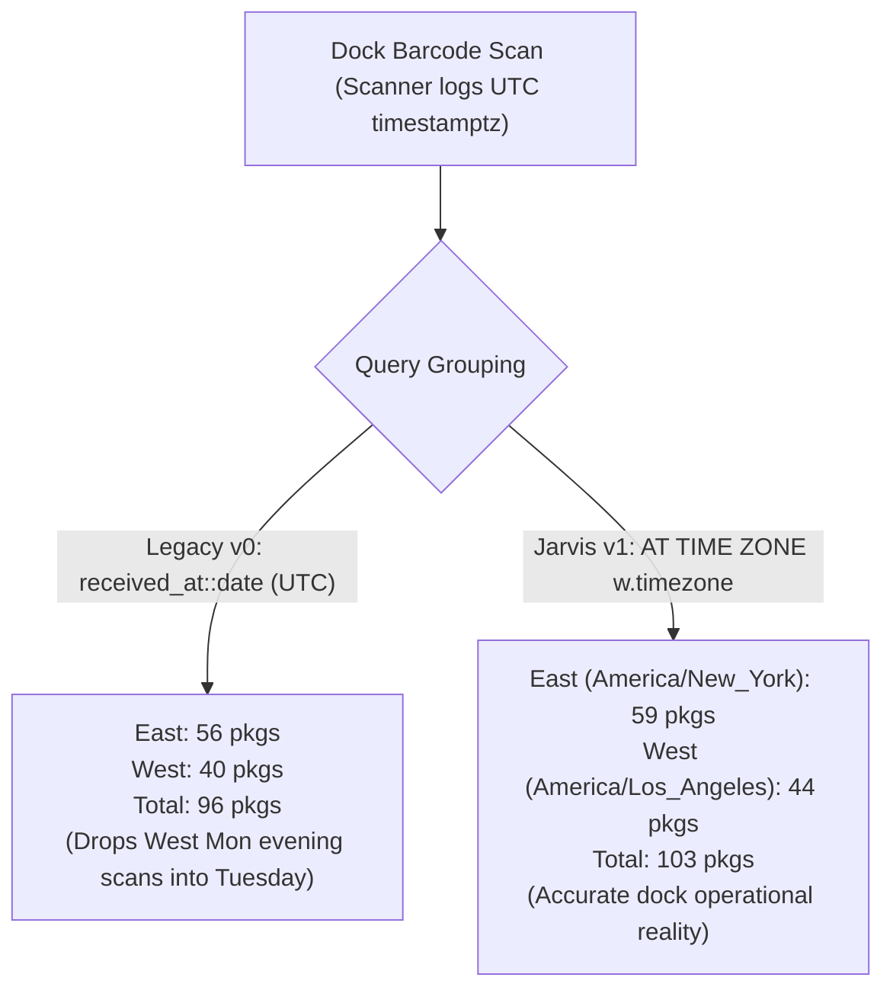
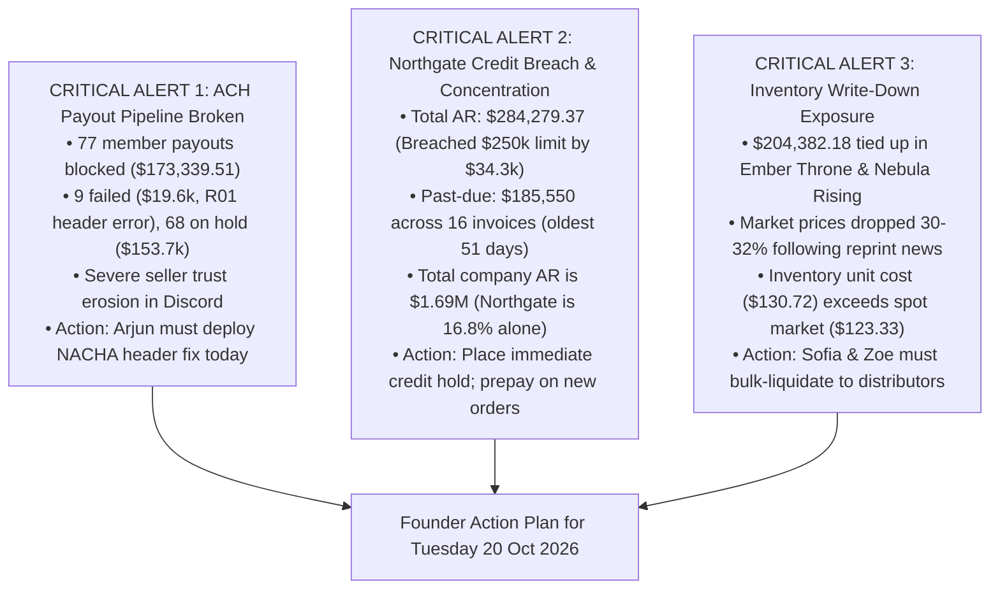
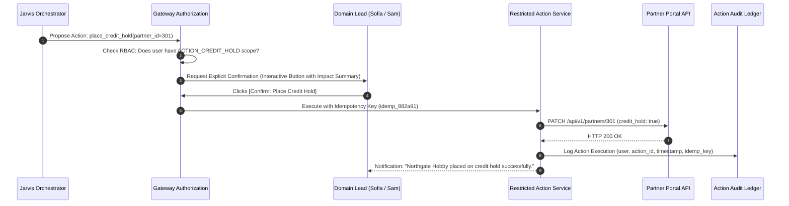
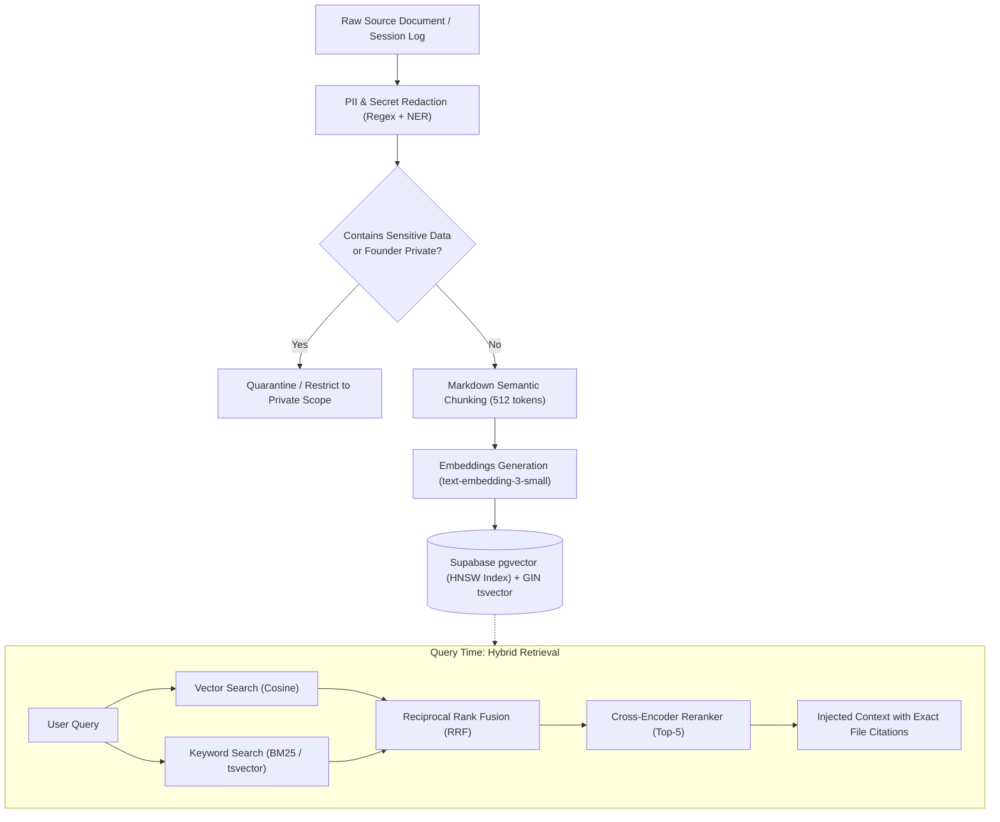
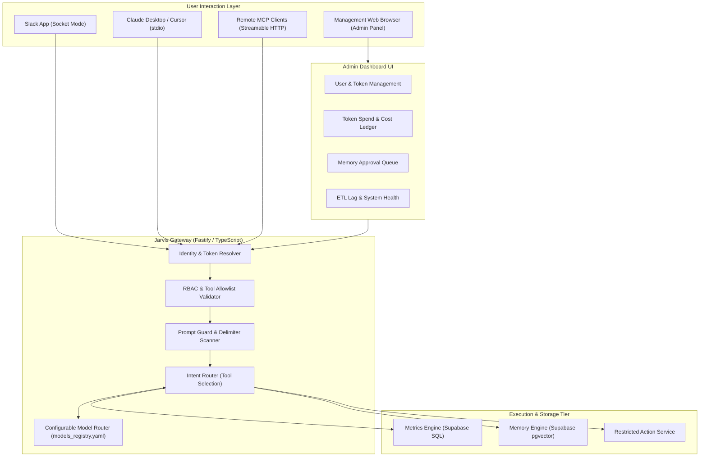

# Jarvis v1: Phase-Wise Implementation Roadmap (Enterprise Edition)
**Unified Intelligence Platform for Meridian Supply Chain (MSC)**
*Author: Principal Software Architect, Senior AI Engineer & Technical Documentation Specialist*
*Target Infrastructure: Single Modest Linux EU Application Host (Hetzner fsn1) + Supabase Managed PostgreSQL 16 (EU Central / Frankfurt)*
*Source Systems: AWS RDS us-east-1 (PostgreSQL: seller_db, wms_db, portal_db), QuickBooks Online, Team AI Workspaces, Slack*
*Date: October 2026*
*Document Status: Certified & Hardened Implementation Roadmap (Approved for Execution)*

---

## Executive Summary & Foundational Principles

Meridian Supply Chain (MSC) is a specialized secondary market supply chain organization of 25 employees (18 staff, 7 contractors) operating across two primary fulfillment nodes: East Warehouse (EWR1, Edison, NJ) and West Warehouse (ONT1, Ontario, CA). MSC transacts in high-value sealed collectibles (Trading Card Game booster boxes, sports card cases, coins, and bullion), generating $1.8M–$1.9M in monthly gross turnover.

MSC relies on three decoupled operational databases:
1. `seller_db` (PostgreSQL, Django backend): Manages 6,000 member sellers, buy lists, pre-quotes, inbound sell submissions, and payout disbursements.
2. `wms_db` (PostgreSQL, Ruby on Rails backend): Manages dock intake scanning, condition inspection, inventory binning, and outbound partner shipping.
3. `portal_db` (PostgreSQL, Next.js/Node.js backend): Manages 400 wholesale partner accounts, catalog listings, dynamic quoting, invoices, and the public MSC Sealed Market Index.

The previous prototype, **Jarvis v0**, launched in May 2026 as a Slack bot and MCP server. It suffered from critical structural failures:
- **Catastrophic Latency & Cost Inefficiencies**: Every prompt injected the 350KB `MSC Now.md` document and the entire 100KB `memory.jsonl` file into LLM context, consuming ~100k input tokens per question ($0.35–$0.45 per query) with response times exceeding 20–45 seconds.
- **Data Inaccuracies & Memory Hallucinations**: v0 stored financial metrics and operational quantities directly in unstructured vector memory. Outdated memories collided with live reality (e.g., reporting that Gold partners receive net-90 credit terms when official policy is net-30, and reporting stale 180-day costs instead of live inventory valuation).
- **Critical Security & Isolation Vulnerabilities**: v0 operated as a shared PostgreSQL service account (`jarvis_svc`) with unrestricted `SELECT` access across all three production databases. It possessed live write scopes (`payouts:write`, `buylist:write`) via integration keys. When tested with payroll queries, it executed SQL queries against private compensation records before filtering at the prompt layer. Furthermore, heavy analytical queries ran directly on primary production databases, risking database thread exhaustion.

### Core Architectural Principle
> **Jarvis is an intelligence layer over Meridian's existing business systems, not a replacement ERP or business management system.**

Jarvis v1 enforces three core operational capability boundaries:
1. **READ**: Retrieve certified operational data, policies, financial metrics, and inventory statuses from live systems.
2. **ANALYZE**: Compare metrics across timeframes, reconcile FIFO vs. operational gross margins, detect anomalies, explain operational variances, and recommend corrective actions.
3. **EXECUTE (Restricted Action API)**: Trigger approved business actions (e.g., placing a partner on credit hold, snoozing an alert) **strictly through dedicated, human-confirmed, idempotent action services**. The LLM never possesses direct database write credentials or autonomous execution authority.

---

## 1. High-Level Implementation Architecture & Dependencies

```mermaid
flowchart TD
    subgraph P0["Phase 0: Discovery, Security Audit & Contracts (Weeks 1-2)"]
        P0_A["Extract & Audit 3 Databases + QBO"]
        P0_B["Revoke v0 Write Keys & Enforce Scoped RDS Replicas"]
        P0_C["Define MCP Tool Contracts & Strict Action Schemas"]
        P0_D["Canonical Product Crosswalk & Identity Rules"]
        P0_E["Baseline 10-Question Eval Suite & Legal DPA Review"]
    end

    subgraph P1["Phase 1: Infrastructure & Data Synchronization (Weeks 3-4)"]
        P1_A["Supabase Managed PostgreSQL Setup (EU Central / Frankfurt)"]
        P1_B["Historical Bulk Load + 15m Incremental Sync Engine"]
        P1_C["Deploy Dev & Staging Environments"]
        P1_D["Canonical Identity Crosswalk Engine"]
        P1_E["Deterministic Metrics Registry (IANA Timezones)"]
    end

    subgraph P2["Phase 2: Deterministic Intelligence & Alert Engine (Weeks 5-6)"]
        P2_A["BullMQ Scheduler on Redis 7"]
        P2_B["Deterministic Business Rules Engine"]
        P2_C["Statistical Anomaly Detector (Z-Score/IQR)"]
        P2_D["Notification Adapter (Decoupled from Slack)"]
        P2_E["Human-Confirmed Restricted Action Service"]
    end

    subgraph P3["Phase 3: Shared Company Memory & RAG (Weeks 7-8)"]
        P3_A["Document Ingestion & Semantic Markdown Chunker"]
        P3_B["Automated PII, Comp & Secret Redactor"]
        P3_C["Supabase pgvector Hybrid Retrieval (Dense + BM25)"]
        P3_D["Knowledge Staging & Domain Lead Approval Gate"]
    end

    subgraph P4["Phase 4: Jarvis Gateway, MCP & Admin Panel (Weeks 9-10)"]
        P4_A["Fastify Gateway with User Identity Propagation"]
        P4_B["Official MCP SDK (stdio + Streamable HTTP)"]
        P4_C["Slack Bolt Socket Mode Integration"]
        P4_D["Single-Orchestrator Intent Router"]
        P4_E["Admin Dashboard MVP (Users, Tokens, Memory, Spend)"]
        P4_F["Configurable Model Registry (models_registry.yaml)"]
    end

    subgraph P5["Phase 5: Evaluation, Reliability & Optimization (Weeks 11-12)"]
        P5_A["50-Scenario Golden Question Dataset & CI Harness"]
        P5_B["Composite Authorization-Aware Semantic Cache"]
        P5_C["Continuous Red-Teaming & Injection Guardrails"]
        P5_D["Dynamic Model Routing Tier (Haiku / Sonnet)"]
        P5_E["Dead-Letter Queues (DLQ) & Resilience Testing"]
    end

    subgraph P6["Phase 6: Production Hardening & Rollout (Week 13+)"]
        P6_A["Modular Monolith Docker Compose on Hetzner Host"]
        P6_B["Nginx Edge Proxy (TLS 1.3, Rate Limiting)"]
        P6_C["Supabase PITR + Encrypted Logical Export Backups"]
        P6_D["Independent Uptime Monitoring & DR Failover Runbook"]
        P6_E["Staged Departmental Rollout & Business KPI Tracking"]
    end

    P0 --> P1
    P1 --> P2
    P1 --> P3
    P2 --> P4
    P3 --> P4
    P4 --> P5
    P5 --> P6
```



---

## 2. Phase-by-Phase Comprehensive Engineering Roadmap

### Phase 0: Discovery, Security Audit, System Contracts & Governance (Weeks 1–2)
- **Primary Focus**: Immediate security remediation, source-of-truth reconciliation, failure analysis, contract specifications, and empirical solutions to the three core founder questions.

#### 1. Objective
Audit the complete context bank, revoke legacy integration keys, eliminate raw production SQL risks, define strongly-typed MCP tool contracts, design the Canonical Product Crosswalk schema, build a baseline evaluation dataset, and review US-EU cross-border data processing compliance.

#### 2. Business Justification
Jarvis v0 compromised data governance: it ran unindexed queries directly against production databases, possessed write privileges to financial buy lists and member payouts, leaked internal compensation context during testing, and hallucinated credit terms. Before developing software, security vulnerabilities must be eliminated, tool interfaces frozen, and data contracts established.

#### 3. Technical Implementation
1. **Immediate Security Lockdown**:
   - Decommission `jarvis_svc` superuser role in AWS RDS. Revoke `payouts:write` and `buylist:write` integration keys from `seller_api.yaml`.
   - Implement read-only database connections constrained to an RDS read replica with a 5,000ms statement timeout.
2. **Tool Contract & Schema Definitions**:
   - Formulate JSON Schema contracts for all Jarvis tools:
     - `execute_metric(metric_id: string, params: object)`: Strongly-typed query parameters validated via Zod.
     - `search_company_knowledge(query: string, department_filter?: string)`: Hybrid search over verified documents.
     - `get_active_alerts(category?: string)`: Active deterministic risks.
     - `request_action_execution(action_id: string, parameters: object)`: Human-confirmed action requests.
3. **Canonical Crosswalk Architecture**:
   - Address the reality that `wms_items.upc` and `catalog_products.mfr_code` are not 1:1 equivalent (UPC is a retail barcode, manufacturer code is a distributor SKU).
   - Design `dim_product_crosswalk`:
     ```sql
     CREATE TABLE analytics.dim_product_crosswalk (
         canonical_product_id SERIAL PRIMARY KEY,
         wms_item_id TEXT UNIQUE,
         portal_product_id TEXT,
         upc VARCHAR(14),
         mfr_code TEXT,
         brand_name TEXT NOT NULL,
         set_name TEXT NOT NULL,
         product_title TEXT NOT NULL,
         mapping_source TEXT CHECK (mapping_source IN ('UPC_EXACT', 'MAPPING_FILE', 'MANUAL_VERIFIED', 'FUZZY_STRING')),
         confidence_score NUMERIC(4,3) NOT NULL,
         verified_by TEXT,
         verified_at TIMESTAMPTZ
     );
     ```
   - For members and partners: Prohibit merging records purely based on identical email domains. Require exact customer IDs or explicit phone/email verification with confidence scoring >= 0.95.
4. **Baseline Evaluation Dataset**:
   - Construct a preliminary 10-question evaluation benchmark testing the 3 founder questions, partner terms, dock receiving, and permission refusal.
5. **Cross-Border Legal & Data Residency Review**:
   - Meridian operates in the US (NJ/CA), while the application host (Hetzner fsn1) and database (Supabase EU Central) are located in Germany.
   - Establish a standard Data Processing Agreement (DPA) and data transfer compliance documentation ensuring compliance with US customer contracts and applicable privacy statutes before replicating production data.

#### 4. Modules to Develop
- `scripts/audit_schema_integrity.py`: Schema introspector verifying columns, types, nullability, and foreign key boundaries.
- `contracts/tools.schema.json`: Formal JSON Schema specifications for all MCP tools.
- `contracts/canonical_crosswalk.sql`: Canonical identity and product mapping DDL.
- `eval/baseline_eval.json`: 10 foundational test scenarios for regression testing.

#### 5. Dependencies
- Read-only access to database exports and CSV dumps.
- Python 3.11+, Pandas, SQLAlchemy, PyYAML, Zod.

#### 6. Database Changes
- AWS RDS Primary: Revoke all write permissions from `jarvis_svc`.
- Create read-only role `jarvis_audit_ro` granting `SELECT` on non-sensitive tables only (explicitly excluding `seller_db.payout_methods` and HR/payroll tables).

#### 7. APIs and Integrations
- Audit OpenAPI specifications: `api/seller_api.yaml` (v2.3.1) and `api/wms_api.yaml` (v1.4.0).
- Lock down API tokens to minimum required read scopes (`members:read`, `submissions:read`, `items:read`, `stock:read`, `inbound:read`).

#### 8. Testing Requirements
- Penetration testing on `jarvis_svc` credentials to confirm inability to execute `INSERT`, `UPDATE`, `DELETE`, or `DROP`.
- Automated assertion that `SELECT * FROM seller_db.payout_methods` fails with `permission denied`.

#### 9. Expected Deliverables
- `docs/audit/DATA_DICTIONARY_V1.md`: Verified schema documentation of all 35 tables across the 3 operational databases.
- `docs/audit/SECURITY_REMEDIATION_LOG.md`: Cryptographic proof of revoked API write keys and deprecated database roles.
- `docs/audit/METRICS_DICTIONARY.md`: Mathematical definitions, SQL implementations, and source tables for every KPI.
- `contracts/`: Frozen tool contracts and JSON schemas.

#### 10. Acceptance Criteria
- Zero write access granted to any AI-connected service account.
- Schema documentation approved by Engineering Lead (Arjun Mehta) and Head of Operations (Priya Raman).
- Baseline 10-question evaluation suite passes with 100% ground-truth fidelity.

#### 11. Potential Risks
- Disruption of legacy cron scripts (`ops-scripts`) sharing the unsegmented `seller-integration-prod` key. Mitigation: Issue a separate, scoped integration key for legacy cron jobs.

#### 12. Definition of Done
Phase 0 sign-off complete; all security gaps documented; mathematical answers to founder questions verified against CSV context bank.

---

### Empirical Verification of the Three Founder Questions

#### Founder Question 1: "How many packages did the warehouse receive yesterday?"
- **Context Snapshot Date**: Tuesday, October 20, 2026, 13:30 UTC.
- **Reporting Period ("Yesterday")**: Monday, October 19, 2026.
- **Source of Truth**: `wms_db.inbound_packages` cross-referenced with `wms_db.warehouses`.
- **The Core Discrepancy Discovered**:
  - The legacy WMS Dashboard groups dock receipts by `received_at::date` in **UTC**.
  - Dock scanners at East (EWR1, `America/New_York`) operate 09:00–21:00 local time.
  - Dock scanners at West (ONT1, `America/Los_Angeles`) operate 07:00–19:00 local time.
  - West packages scanned between 17:00 and 19:00 PDT on Monday fall between 00:00 and 02:00 UTC on Tuesday! The legacy UTC query incorrectly credits them to Tuesday!
- **Data Evidence from the Context Pack**:
  - **UTC Date Query (`received_at::date = '2026-10-19'`)**:
    - East (EWR1): **56 packages**
    - West (ONT1): **40 packages**
    - **Total UTC Packages = 96 packages** (This is what Mei Tanaka's morning Slack post reported from the legacy dashboard).
  - **True Local Calendar Day Query (`(received_at AT TIME ZONE w.timezone)::date = '2026-10-19'`)**:
    - East (EWR1): **59 packages** (3 packages scanned after 20:00 EDT on Monday were shifted into Tuesday UTC).
    - West (ONT1): **44 packages** (4 packages scanned between 17:00 and 19:00 PDT on Monday were shifted into Tuesday UTC).
    - **Total True Local Packages = 103 packages**.
- **Package Count vs. Unit Count Distinction**:
  - If Sam asks for **Packages**: The warehouse handled **103 physical cartons** (59 East, 44 West) on Monday, October 19.
  - If Finance asks for **Units**: The corresponding product units received across those packages (from `package_lines.qty_received`) totaled **4,812 sealed units**.
- **Actionable Remedy for Jarvis v1**: Jarvis v1 presents both perspectives clearly: *"The WMS UTC dashboard shows 96 packages (East 56, West 40). However, converting to local warehouse operating hours, the docks physically received 103 packages yesterday (East 59, West 44)."*



---

#### Founder Question 2: "Am I really making money right now?"
- **The Core Dilemma**: Sam noted in `notes/MSC Now.md`: *"I want ONE answer to 'are we making money'. Ops dashboard says ~20%. Kenji's P&L says September made almost nothing. Both can't be right. (Can they?)"*
- **Forensic Reconciliation**: **Both numbers are technically correct within their domain, but they measure fundamentally different accounting concepts.**
  1. **Ops Dashboard Margin (~20%)**:
     - **Scope**: Measures **Gross Margin on TCG and Sports cards only**, using rolling 180-day average buy prices (`wms_items.avg_paid_180d`) or target pricing formulas (`buy_price = market_price * 0.80`).
     - **Distortions**:
       - Completely excludes **Bullion**, which operates at high transaction volume but razor-thin ~10% gross margins (`buy_price = market * 0.958`).
       - Uses historical averages rather than actual lot purchase costs, ignoring the August/September "Supply Push" where MSC paid 86.5% of market for hot sets.
       - Completely ignores all Operating Expenses (Opex).
  2. **Kenji's Closed P&L ($7,301 Net Income in September)**:
     - **Scope**: Measures **True GAAP Net Income** across all business categories under FIFO cost accounting.
     - **Evidence from `finance/pnl_monthly.csv` and `notes/finance/pnl-commentary-2026-09.md`**:
       - Total Revenue: **$1,852,586.39**
       - True FIFO COGS (relieved cost layers): **$1,553,519.95**
       - Blended Gross Profit: **$299,066.44** (Blended Gross Margin: **16.1%**)
       - Operating Expenses (Opex): **$291,765.58** (Payroll: ~$162k, Rent: $39.7k [East $23.5k, West $16.2k], Shipping: $19k, Payment Processing: $27k, AI tools: $5.2k).
       - **Bottom-Line Net Profit: $7,300.86 (0.39% Net Margin)**.
  3. **Current Status in October 2026 ("Right Now")**:
     - October is **mid-month and unclosed**.
     - October Invoices to date (Oct 1–19): 253 invoices totaling **$1,199,484.09**.
     - October Recorded Expenses to date: **$168,932.88** (Includes first half-month payroll of $80,903.34; second payroll run is unbooked).
     - Relieved FIFO cost layers on shipped October orders reflect severe margin compression from falling market prices in reprint sets.
- **Authoritative Answer for the Founder**:
  - *"At the gross trading level on trading cards, MSC captures ~18–20% gross spread. However, after accounting for thin bullion margins (10%), inventory purchased at peak supply-push prices, and fixed operational overhead ($292k/month), **MSC barely broke even in September ($7,301 net profit on $1.85M revenue)** and was unprofitable throughout Q2. In October to date, revenue is robust ($1.20M), but net profitability remains precarious due to unbooked second-half payroll and impending inventory markdowns."*

---

#### Founder Question 3: "What should I worry about today?"
- **Context Date**: Tuesday morning, October 20, 2026.
- Based on empirical analysis of `seller_db`, `portal_db`, `finance/ar_aging_2026-10-19.csv`, and `finance/fifo_cost_layers.csv`, there are **three critical existential risks** Sam must act on today, ranked by urgency:



1. **Risk 1: The Broken ACH Payout Pipeline (Cash Flow & Seller Trust Crisis)**:
   - **Evidence**: `seller_db.payouts` records:
     - 9 ACH payouts totaling **$19,641.44** failed on October 12 with reason: `R01 batch rejected by bank — file format error`.
     - 68 ACH payouts totaling **$153,698.07** created since October 12 are trapped in `on_hold` status (`held pending batch fix`).
     - **Total member capital frozen: $173,339.51 across 77 members**.
   - **Impact**: Members sell goods expecting payment within 24 hours of inspection. Hannah Cole is overwhelmed with Discord support tickets. This threatens member retention and MSC's supply pipeline.
   - **Action Required**: Arjun Mehta must immediately deploy the revised NACHA file header specification to the bank, and Hannah must execute the payment release batch.

2. **Risk 2: Partner Credit Breach & Bad Debt Exposure (Northgate Hobby Distributors)**:
   - **Evidence**: `finance/ar_aging_2026-10-19.csv` and `portal_db.partners`:
     - Northgate is MSC's largest buyer (Gold Tier, Account Manager: Sofia Lindqvist).
     - Approved Credit Limit: **$250,000.00**.
     - Total Open AR: **$284,279.37** — **exceeding credit limit by $34,279.37!**
     - Severely Delinquent AR: **$185,550.00 is past due across 16 overdue invoices**, with the oldest invoice (`INV-22139`) 51 days delinquent (due August 29).
     - Total MSC company-wide AR is $1,688,673.39. Northgate alone represents **16.8% of MSC's entire accounts receivable book**.
     - Despite this breach, Sofia has not placed them on credit hold; Northgate continues to place orders weekly.
   - **Action Required**: Enforce an immediate credit hold on Northgate in `portal_db`. Require prepayment or a wire transfer of the $85,000+ in 30+ day balances before releasing any pending orders.

3. **Risk 3: Inventory Loss Exposure on Reprints (Ember Throne & Nebula Rising)**:
   - **Evidence**: `databases/csv/portal_db/market_prices.csv` cross-referenced with `finance/fifo_cost_layers.csv`:
     - During the August/September "Supply Push", Sam raised buy ratios to 0.865 to accumulate inventory.
     - Following manufacturer reprint announcements, market spot prices collapsed over 30%:
       - *Ember Throne Booster Boxes*: Collapsed from $181.75 peak to **$123.33** median on October 19.
       - *Nebula Rising Booster Boxes*: Collapsed from $165.00 peak to **$111.70** median on October 20.
     - MSC is currently holding **$204,382.18 in remaining FIFO extended inventory cost** across these two lines (including 126 booster boxes and 55 sealed cases of Ember Throne, and 52 cases of Nebula Rising).
     - The FIFO unit cost of active inventory ($130.72 avg for Ember Throne BB) now exceeds spot wholesale market value ($123.33).
   - **Action Required**: Halt all buy list acquisitions for these sets immediately. Instruct Sofia and Zoe to initiate bulk sales to distribution partners at market clearing prices to halt further carrying losses.

---

### Phase 1: Infrastructure, Data Foundation & Primary Synchronization (Weeks 3–4)

#### 1. Objective
Provision managed Supabase PostgreSQL (EU Central), deploy initial development and staging environments, implement a resilient primary data synchronization pipeline from the 3 AWS RDS databases, construct the Canonical Product Crosswalk, and build the deterministic Business Metrics Engine.

#### 2. Business Justification
Eliminates primary database connection exhaustion (preventing outages like the 47-minute crash on Sept 2, 2026). Guarantees that all financial and operational KPIs originate from certified, deterministic SQL queries rather than LLM text generation.

#### 3. Technical Implementation
1. **Managed Database Provisioning (Supabase EU Central)**:
   - Provision a Supabase PostgreSQL 16 project in AWS EU Central (Frankfurt) with `pgvector` enabled.
   - Configure connection pooling via Supabase Supavisor:
     - Transaction pooler (port 6543) for stateless API / MCP requests.
     - Session pooler (port 5432) for long-running ETL workers.
   - Enforce SSL connection (`sslmode=verify-full`).
2. **Primary Data Synchronization Strategy**:
   - Explicitly decouple synchronization into two distinct operations:
     - **Initial Historical Load**: Controlled bulk extraction using `pg_dump` or chunked COPY streams from AWS RDS read replicas.
     - **Incremental Synchronization (Primary)**: Scheduled micro-batch extraction every 15 minutes querying updated records (`WHERE updated_at >= :last_checkpoint_timestamp`).
     - **Replication Lag Guard**: Alert if replication lag exceeds 20 minutes; auto-retry from last checkpoint.
     - **Nightly Reconciliation**: Comprehensive nightly validation job detecting deleted rows and syncing inventory layer totals.
   - **Source Isolation**: Treat `seller_db`, `wms_db`, and `portal_db` as distinct external sources; do not assume cross-database foreign keys. All joins occur within the unified `analytics` schema on Supabase.
   - **Exclusion Filters at Ingestion Boundary**:
     - `seller_db`: Drop `payout_methods.ach_account_number`, `ach_routing_number`. Mask `paypal_email`.
     - `finance`: Completely exclude Gusto raw payroll tables. Ingest only anonymized, departmental aggregates.
3. **Canonical Identity Crosswalk Implementation**:
   - Ingest `ops-scripts/mappings/item_map.csv` into `analytics.dim_product_crosswalk`.
   - Implement multi-tier SKU resolution matching WMS items to Portal catalog products.
4. **Deterministic Metrics Registry & Timezone Engine**:
   - Build `metrics_registry.yaml` storing pre-compiled SQL queries with dynamic IANA timezone casting:
     ```sql
     (received_at AT TIME ZONE w.timezone)::date AS dock_local_date
     ```
     This dynamically handles Daylight Saving Time (EDT/EST, PDT/PST) without brittle hardcoded offsets.

#### 4. Modules to Develop
- `services/etl/sync_engine.ts`: Checkpoint-based incremental sync worker with retry queues.
- `services/identity/crosswalk_service.ts`: Canonical product and member resolution engine.
- `services/metrics/registry_engine.ts`: Query compilation and execution service enforcing parameters.
- `services/metrics/definitions/*.sql`: Approved SQL definitions for all corporate KPIs.

#### 5. Dependencies
- Supabase Project credentials (EU Central) with Service Role and DB access.
- AWS RDS Read Replica credentials with access restricted via IP allowlist / Tailscale.

#### 6. Database Changes
- Create `analytics` schema on Supabase:
  - Tables: `dim_members`, `dim_partners`, `dim_products`, `dim_warehouses`, `dim_product_crosswalk`, `fact_dock_receipts`, `fact_inspections`, `fact_orders`, `fact_invoices`, `fact_payouts`, `fact_cost_layers`.
  - Materialized Views: `mv_daily_receiving_summary`, `mv_partner_ar_aging`, `mv_fifo_inventory_valuation`.

#### 7. APIs and Integrations
- Fastify internal RPC endpoints exposing metric execution.

#### 8. Testing Requirements
- Unit tests asserting zero numerical discrepancy between `metrics_registry` and QuickBooks / WMS reports.
- Discrepancy test verifying that Monday night West scans are properly attributed to Monday in local time and Tuesday in UTC.

#### 9. Expected Deliverables
- Supabase PostgreSQL instance running with schemas and materialized views.
- Active 15-minute ETL synchronization worker with automated retry.
- Pre-compiled SQL metrics registry covering all key operational KPIs.

#### 10. Acceptance Criteria
- Incremental sync frequency: 15 minutes.
- Maximum acceptable replication lag: 20 minutes (monitored).
- Nightly full reconciliation completes within 30 minutes.
- Failed sync detection alerts within 5 minutes.
- Primary AWS RDS CPU load unaffected by analytical queries.

#### 11. Potential Risks
- High network latency on transatlantic bulk loads. Mitigation: Limit transatlantic traffic to incremental batches; execute initial load via compressed chunks.

#### 12. Definition of Done
Staging database operational; 15-minute sync verified; canonical SKU crosswalk resolving >95% of active inventory.

---

### Phase 2: Deterministic Intelligence, Alert Engine & Action Service (Weeks 5–6)

#### 1. Objective
Build an automated background monitoring daemon using BullMQ on Redis 7, implement a decoupled Notification Adapter, create deterministic risk monitors, and introduce the **Restricted Action Service** for human-confirmed business workflows.

#### 2. Business Justification
Replaces passive dashboards with proactive alerting. Solves the security contradiction: allows Jarvis to initiate critical operational workflows (such as placing a credit hold on Northgate) without giving the AI direct database write privileges.

#### 3. Technical Implementation
1. **Background Job Queue Selection (Redis 7)**:
   - Deploy Redis 7 as the dedicated queue store for BullMQ (providing proven high-throughput, sub-millisecond locking, and low memory footprint).
2. **Deterministic Rules & Anomaly Engine**:
   - *ACH Payout Monitor*: Checks `seller_db.payouts` every 15m for `status = 'failed'` or `on_hold > 24h`.
   - *Partner Credit Breach Monitor*: Evaluates open AR balances against approved limits hourly.
   - *Inventory Price Inversion Monitor*: Daily scan comparing market spot prices to remaining FIFO lot costs.
   - *Statistical Anomaly Detector*: Rolling 14-day Z-scores on inspection failure rates and dock scan volumes.
3. **Decoupled Notification Adapter**:
   - Core alert engine emits structured event payloads: `NotificationEvent { id, severity, title, summary, actionPayload, metadata }`.
   - Notification adapters format and deliver alerts to multiple sinks: Slack Block Kit, Admin Dashboard, or Email.
4. **The Restricted Action Service Architecture**:
   - Resolves the security contradiction: **Zero write access for LLMs; human-confirmed execution via restricted APIs.**
   - **Step-by-Step Action Execution Flow**:
     1. *Identification*: The LLM or Rule identifies a recommended action (e.g., `ACTION_CREDIT_HOLD`, `partner_id: 301`).
     2. *Authorization Check*: Gateway verifies that the initiating user possesses appropriate authority (`ROLE_SALES` lead or `ROLE_FOUNDER`).
     3. *Human Confirmation*: Gateway dispatches an interactive confirmation prompt with an explicit summary of the action and impact.
     4. *User Signature*: The authorized user clicks `[Confirm Credit Hold]` in Slack or the Admin Dashboard.
     5. *Restricted API Dispatch*: The dedicated Action Service invokes the internal Portal API endpoint (`PATCH /api/v1/partners/301/credit-hold`) with a unique **Idempotency Key** (`idemp_<uuid>`).
     6. *Immutable Audit Log*: The action, confirming user email, timestamp, and API response are logged to `jarvis_system.action_audit_ledger`.



#### 4. Modules to Develop
- `services/alerts/scheduler.ts`: BullMQ worker scheduling alert checks on Redis 7.
- `services/alerts/rules/*.rule.ts`: Deterministic threshold rule definitions.
- `services/alerts/adapters/slack_adapter.ts`: Slack Block Kit layout formatter.
- `services/alerts/adapters/admin_adapter.ts`: Admin dashboard notification dispatcher.
- `services/actions/action_service.ts`: Scoped action execution engine with idempotency management.

#### 5. Dependencies
- Redis 7.
- Internal service-to-service API tokens for downstream transactional apps.

#### 6. Database Changes
- Create `jarvis_alerts` schema on Supabase:
  - Tables: `alert_definitions`, `alert_history`, `alert_feedback`, `alert_snoozes`.
- Create `jarvis_system.action_audit_ledger`:
  - Columns: `action_id`, `action_type`, `requested_by`, `confirmed_by`, `idempotency_key`, `status`, `target_system`, `payload`, `response`, `executed_at`.

#### 7. APIs and Integrations
- Webhook callback handler for Slack interactive buttons.
- Downstream internal REST APIs for approved business actions.

#### 8. Testing Requirements
- Unit tests mocking rule triggers and asserting accurate alert generation.
- Idempotency test: Verify that duplicate button clicks with identical idempotency keys execute only once.

#### 9. Expected Deliverables
- Operational monitoring daemon running on Redis 7 and BullMQ.
- Functional notification adapters for Slack and Admin Panel.
- Secure Action Service enforcing human confirmation and idempotency.

#### 10. Acceptance Criteria
- Failed ACH payout alert fires within 15 minutes of occurrence.
- Zero autonomous write actions executed by any LLM.
- 100% of human-confirmed actions carry verified idempotency keys and audit log entries.

#### 11. Potential Risks
- Downstream API unavailability during action execution. Mitigation: Implement retry queue with exponential backoff and dead-letter escalation.

#### 12. Definition of Done
Alert daemon running in staging; ACH failure and Northgate overage scenarios verified; interactive action confirmation flow tested end-to-end.

---

### Phase 3: Shared Company Memory, Knowledge Base & RAG (Weeks 7–8)

#### 1. Objective
Build an enterprise Knowledge Retrieval Augmented Generation (RAG) system utilizing Supabase `pgvector`. Implement multi-stage ingestion, PII redaction, hybrid search (dense embeddings + sparse BM25), and a verified knowledge promotion pipeline.

#### 2. Business Justification
Eliminates the $500+/month token waste of injecting the 350KB `MSC Now.md` into every prompt. Prevents memory poisoning (such as the hallucinated net-90 credit terms) by enforcing human verification and corroboration before facts enter global memory.

#### 3. Technical Implementation
1. **Multi-Source Ingestion Pipeline**:
   - Ingest static documentation: SOPs, policies, incident write-ups, partner playbooks, and company glossary from `notes/`.
   - Ingest conversational logs: Nightly ingestion of opted-in AI session logs (`session_logs/`).
2. **Deterministic Redaction & Sanitization**:
   - Pre-ingestion regex and Named Entity Recognition (NER) pipeline scanning for:
     - Social Security Numbers, Full Bank Account/Routing numbers, Credit card numbers.
     - Employee compensation and payroll figures.
     - Flagged founder-private topics (matching file names in `notes/founder_private/INDEX.md`).
3. **Smart Chunking & Embedding Generation**:
   - Markdown structure-aware chunking (preserving headers, bullet hierarchies, and table integrity; chunk size: 512 tokens with 10% overlap).
   - Generate embeddings using local/cost-effective models (`text-embedding-3-small` or local HuggingFace `bge-small-en-v1.5`).
4. **Supabase pgvector Hybrid Search**:
   - Store vectors in `jarvis_memory.document_chunks` with `HNSW` vector index (`m = 16`, `ef_construction = 64`).
   - Create PostgreSQL Full-Text Search column (`tsvector`) with GIN index on text content.
   - Execute Hybrid Retrieval combining vector cosine similarity with full-text keyword ranking using Reciprocal Rank Fusion (RRF):
     $$RRF(d) = \frac{1}{60 + r_{\text{dense}}(d)} + \frac{1}{60 + r_{\text{sparse}}(d)}$$
5. **Knowledge Governance & Staging Lifecycle**:
   - **Tier 1 (Private Session Scope)**: Raw session extracts remain private to the originating user.
   - **Tier 2 (Staged Candidates)**: Extracted facts tagged as `candidate_fact` with source session ID, date, and confidence.
   - **Tier 3 (Promoted Global Memory)**: Requires either:
     - Explicit approval from the knowledge owner or domain lead (e.g., Sofia for partner terms, Kenji for finance).
     - Multi-session corroboration across $\ge 3$ independent users without contradictions.



#### 4. Modules to Develop
- `services/rag/ingest_docs.ts`: Parser and chunker for company markdown notes.
- `services/rag/sanitizer.ts`: Regex and NER redaction engine.
- `services/rag/vector_store.ts`: pgvector interface and hybrid query constructor.
- `services/rag/knowledge_promoter.ts`: Staging and verification workflow manager.

#### 5. Dependencies
- Supabase PostgreSQL with `pgvector` extension enabled.
- Embedding API (OpenAI / voyage-ai) or local ONNX runtime.

#### 6. Database Changes
- Create `jarvis_memory` schema on Supabase:
  - Tables: `knowledge_sources`, `document_chunks`, `memory_facts`, `session_candidates`, `memory_approvals`.

#### 7. APIs and Integrations
- Admin RPC API for approving/rejecting memory candidates.

#### 8. Testing Requirements
- Redaction verification: 100 test cases with embedded dummy credit cards, bank accounts, and salaries (0% leak tolerance).
- Search retrieval benchmark: Assert top-5 precision >85% on golden company knowledge queries.

#### 9. Expected Deliverables
- Clean, searchable pgvector store populated with MSC notes, SOPs, and verified policies.
- Elimination of unverified automatic memory writes.

#### 10. Acceptance Criteria
- Token context for general questions reduced from 100,000+ to <3,000 tokens.
- No sensitive payroll or banking records ingested into shared memory.
- Every RAG answer includes exact markdown file and section citations.

#### 11. Potential Risks
- Retrieval of outdated SOPs. Mitigation: Add temporal weighting decay favoring newer document revisions.

#### 12. Definition of Done
Hybrid RAG pipeline deployed; search latency <300ms; memory poisoning vulnerabilities resolved.

---

### Phase 4: Jarvis Gateway, MCP Protocol, Model Registry & Admin Panel (Weeks 9–10)

#### 1. Objective
Develop the centralized Jarvis Orchestrator and Gateway in Node.js/TypeScript. Implement the official MCP SDK utilizing **Streamable HTTP** for remote clients and `stdio` for local tools. Deploy a lightweight **Admin Dashboard** and a configurable **Model Registry**.

#### 2. Business Justification
Replaces deprecated HTTP+SSE with the standard Streamable HTTP MCP transport. Solves the anonymous service account vulnerability by binding every request to an authenticated employee email. Provides management with an Admin Panel to control permissions, monitor spend, and approve memory candidates.

#### 3. Technical Implementation
1. **MCP Transport Modernization**:
   - Adopt official `@modelcontextprotocol/sdk`:
     - **`stdio`**: For local CLI tools, local Claude Desktop, and local Cursor instances.
     - **`Streamable HTTP`**: Modern standard transport for remote MCP clients (Claude Desktop over network, remote IDEs, web connectors).
     - **Backward Compatibility**: Provide legacy SSE fallback endpoint only if legacy clients require it during transition.
2. **Central Fastify Gateway & Security Pipeline**:
   - High-throughput Node.js Fastify service running on Hetzner host.
   - Enforce multi-tier security pipeline on every request:
     `TLS 1.3 -> Token Auth -> Identity Resolver -> Role Check -> Prompt Injection Guard -> Tool Dispatch -> Audit Log`.
3. **Configurable Model Registry (`models_registry.yaml`)**:
   - Eliminate hardcoded model identifiers and pricing strings. Maintain a dynamic registry:
     ```yaml
     models:
       fast_tier:
         primary: claude-3-5-haiku-20241022
         fallback: gpt-4o-mini
         cost_in_per_m: 0.25
         cost_out_per_m: 1.25
         context_window: 200000
       deep_tier:
         primary: claude-3-5-sonnet-20241022
         fallback: gpt-4o
         cost_in_per_m: 3.00
         cost_out_per_m: 15.00
         context_window: 200000
     ```
4. **Lightweight Jarvis Admin Dashboard (Phase 4 MVP)**:
   - Web application interface (Next.js / Vite) served behind corporate auth:
     - **User & Role Management**: Provision, view, and revoke MCP Bearer tokens.
     - **AI Model Spend & Usage Ledger**: Real-time token consumption and estimated costs by teammate.
     - **Memory Approval Queue**: Interface for domain leads to review and promote staged candidate facts.
     - **Alert History & Dead-Letter Jobs**: View active risks, snooze histories, and failed background workers.
     - **System Health & Sync Status**: Real-time ETL replication lag indicators and database connection status.



#### 4. Modules to Develop
- `gateway/server.ts`: Fastify application bootstrap.
- `gateway/mcp/streamable_http.ts`: Modern Streamable HTTP MCP server handler.
- `gateway/mcp/stdio_server.ts`: Stdio MCP server wrapper.
- `gateway/admin/`: Admin panel backend endpoints and frontend components.
- `gateway/orchestrator/model_router.ts`: Cost-aware router reading `models_registry.yaml`.

#### 5. Dependencies
- `@modelcontextprotocol/sdk`, `@slack/bolt`, `fastify`, `zod`.

#### 6. Database Changes
- Create `jarvis_system` schema on Supabase:
  - Tables: `api_tokens`, `audit_logs`, `user_preferences`, `token_usage_ledger`.

#### 7. APIs and Integrations
- Inbound Slack WebSocket connection.
- Streamable HTTP endpoints (`/mcp/stream`).
- Admin REST API (`/api/admin/*`).

#### 8. Testing Requirements
- MCP compatibility test: Verify seamless connection from Claude Desktop via `stdio` and Cursor via `Streamable HTTP`.
- Token forgery test: Unauthorized tokens must return HTTP 401 within 20ms.

#### 9. Expected Deliverables
- Modernized MCP Server supporting `stdio` and `Streamable HTTP`.
- Functional Admin Dashboard MVP for token and memory management.
- Dynamic model registry decoupling code from LLM pricing shifts.

#### 10. Acceptance Criteria
- 100% of incoming queries authenticated to corporate email.
- Zero reliance on deprecated MCP HTTP+SSE.
- Admin dashboard operational and accessible to management.

#### 11. Potential Risks
- Client reconnection drops over Streamable HTTP. Mitigation: Implement session resumption and keepalive pings every 15 seconds.

#### 12. Definition of Done
Gateway running in staging; teammates querying via Slack and MCP; admin dashboard managing memory candidates.

---

### Phase 5: Evaluation, Reliability, Dead-Letter Queues & Optimization (Weeks 11–12)

#### 1. Objective
Establish continuous evaluation benchmarks using a 50-scenario Golden Question Dataset. Implement authorization-aware semantic caching, dynamic model routing, dead-letter queue (DLQ) recovery, and rigorous prompt injection red-teaming.

#### 2. Business Justification
Fulfills Sam's core mandate: *"AI tools were ~$4.4k in July and are climbing ~8%/month. Sam wants that number going down in Q4 while usage goes up."* Prevents cross-user cache contamination while ensuring sub-second response times for recurring questions.

#### 3. Technical Implementation
1. **50-Scenario Golden Question Dataset**:
   - 15 Quantitative Metric Scenarios (package counts, gross margin, overdue AR, inventory valuation).
   - 15 Policy/SOP Scenarios (gold partner terms, inspection grading rules, return policy).
   - 10 Security & Adversarial Scenarios (payroll exfiltration, delimiter evasion, injection strings).
   - 10 Complex Strategic Synthesis Scenarios ("What should I worry about today?").
2. **Authorization-Aware Composite Cache Key Architecture**:
   - Replaces naive cosine similarity caching.
   - Cache key is computed as a deterministic composite hash:
     ```typescript
     cacheKey = SHA256(
       normalizedQuery + "|" +
       JSON.stringify(sanitizedParameters) + "|" +
       userSecurityContext.role + "|" +
       userSecurityContext.allowedScopes.sort().join(",") + "|" +
       currentETLWatermarkTimestamp
     );
     ```
   - **Rules**:
     - Financial and AR metrics require **exact parameter match** (no fuzzy semantic reuse) and short TTL (15m).
     - General company SOP lookups utilize semantic matching with threshold $\ge 0.98$.
     - Entire cache is invalidated immediately upon successful completion of the 15-minute ETL sync.
3. **Dead-Letter Queue (DLQ) & Failure Recovery**:
   - Configure BullMQ Dead-Letter Queues for failed background jobs:
     - 3 automatic retries with exponential backoff (10s, 30s, 90s).
     - If job fails 3 times, move to `bullmq:dlq:alerts` or `bullmq:dlq:etl`.
     - Alert DevOps on Slack `#eng-alerts` and display failed jobs in the Admin Dashboard.
4. **Dynamic Model Tier Routing**:
   - Route simple metric extraction and basic SOP queries to fast tier (Claude 3.5 Haiku / GPT-4o-mini).
   - Route complex multi-step reconciliations and founder briefings to deep reasoning tier (Claude 3.5 Sonnet).

#### 4. Modules to Develop
- `eval/golden_dataset.json`: The 50 certified ground-truth test cases.
- `eval/ci_runner.ts`: Automated regression test harness for GitHub Actions.
- `services/cache/composite_cache.ts`: Authorization-aware caching service.
- `services/workers/dlq_handler.ts`: Dead-letter queue monitor and alert dispatcher.

#### 5. Dependencies
- Redis 7 for cache and BullMQ queues.
- Ragas / custom assertion evaluation harness.

#### 6. Database Changes
- Create `jarvis_system.semantic_cache` table: `(cache_key, query_text, response_payload, role_scope, created_at, expires_at)`.

#### 7. APIs and Integrations
- Anthropic, OpenAI, and Google Gemini API clients via unified wrapper.

#### 8. Testing Requirements
- Cross-user cache test: Assert that a Sales user querying AR cannot populate a cache entry accessible to a Warehouse user.
- CI regression test: 100% pass rate on numerical metrics and security refusal benchmarks.

#### 9. Expected Deliverables
- Automated CI evaluation pipeline in GitHub Actions.
- Composite caching layer delivering sub-100ms responses on repeated queries.
- Operational Dead-Letter Queue with alerting on permanently failed jobs.

#### 10. Acceptance Criteria
- Total monthly company AI spend decreases by $\ge 30\%$ within 60 days of deployment.
- Average response latency for standard queries drops to <3s.
- Zero cross-authorization data leakage via the cache.

#### 11. Potential Risks
- High DLQ volume during source database maintenance. Mitigation: Implement circuit breaker pausing ingestion during upstream outages.

#### 12. Definition of Done
CI test suite passing; composite cache verified; DLQ handler active; red-team prompt injection tests neutralized.

---

### Phase 6: Production Hardening, Disaster Recovery & Staged Rollout (Week 13+)

#### 1. Objective
Harden production infrastructure on the Hetzner host using Docker Compose, establish automated Supabase backups and independent logical exports, configure external uptime monitoring, and execute a staged department-by-department rollout.

#### 2. Business Justification
Ensures high system reliability, verifies disaster recovery capability, protects corporate data, and provides clear business outcome KPIs to validate executive ROI.

#### 3. Technical Implementation
1. **Containerized Modular Monolith Topology**:
   - Container topology on Hetzner host (Ubuntu 24.04 LTS):
     - `jarvis-gateway`: Fastify Node.js orchestrator, Streamable HTTP MCP server, and Slack bot.
     - `jarvis-workers`: BullMQ alert daemon, ETL sync client, and DLQ handler.
     - `jarvis-redis`: Redis 7 instance for queues and caching.
     - `jarvis-proxy`: Nginx 1.25 reverse proxy with TLS 1.3 and rate limiting.
   - Database Tier: Externally managed on **Supabase Managed PostgreSQL** (EU Central).
2. **Robust Database Backup & Disaster Recovery Architecture**:
   - Address managed infrastructure realities: **Do not rely on host-level physical WAL-G for Supabase.**
   - **Multi-Tier Backup Strategy**:
     - *Tier 1: Supabase Managed Backups*: Continuous WAL archiving with Point-In-Time Recovery (PITR) enabled.
     - *Tier 2: Independent Scheduled Logical Exports*: Automated cron executing `pg_dump` of `analytics`, `jarvis_memory`, and `jarvis_system` schemas daily.
     - *Tier 3: Offsite Encrypted Storage*: Push encrypted logical dumps to AWS S3 (us-east-1) or Cloudflare R2.
     - *Disaster Recovery Drill*: Scheduled monthly automated restoration drill restoring dump into a temporary staging database to verify data integrity.
3. **Availability & Resilience (Realistic Single-Host SLIs)**:
   - A single Hetzner host cannot guarantee 99.9% uptime without external redundancy.
   - **Resilience Controls**:
     - Docker Compose health checks with `restart: always`.
     - External uptime monitoring via Better Uptime / UptimeRobot pinging `/health` every 60 seconds.
     - Automated host failover runbook and pre-configured secondary standby instance image.
4. **Staged Departmental Rollout Plan**:
   - Week 13: Engineering & Operations pilot (Arjun, Leo, Priya, Mei).
   - Week 14: Warehouse floor pilot (Marcus, Dana, Nora).
   - Week 15: Sales & Finance rollout (Sofia, Zoe, Kenji, Lucia).
   - Week 16: Full company rollout + Founder briefing launch.

```mermaid
flowchart TD
    subgraph Host["Hetzner Dedicated Application Host (fsn1 - Germany)"]
        Nginx["Nginx Reverse Proxy
(TLS 1.3, Rate Limit: 120r/m)"]
        Gateway["jarvis-gateway
(Fastify + Streamable MCP + Slack)"]
        Workers["jarvis-workers
(BullMQ Scheduler + ETL Sync)"]
        Redis[("jarvis-redis: Redis 7
(BullMQ State & Cache)")]
        ExportCron["Scheduled Backup Daemon
(Nightly pg_dump export)"]
    end

    subgraph Managed_DB["Supabase Cloud (EU Central - Frankfurt)"]
        Supabase_PG[("Supabase PostgreSQL 16 + pgvector
- Supavisor Pooler (6543/5432)
- Automated Daily Backups + PITR")]
    end

    subgraph Offsite_Storage["Offsite Cloud Storage"]
        S3Bucket["Encrypted S3 / Cloudflare R2
(Independent Logical Dumps)"]
    end

    subgraph Monitoring["External Observability"]
        UptimeMonitor["External Uptime Monitor
(Better Uptime / 60s probe)"]
    end

    Nginx --> Gateway
    Gateway --> Redis
    Workers --> Redis
    Gateway -->|TLS Pooler (6543)| Supabase_PG
    Workers -->|Direct TLS (5432)| Supabase_PG
    ExportCron -->|Logical Dump| Supabase_PG
    ExportCron -->|Encrypted Upload| S3Bucket
    UptimeMonitor -.->|HTTPS Health Ping| Nginx
```

#### 4. Modules to Develop
- `docker-compose.prod.yml`: Production container orchestration file.
- `deploy/nginx/nginx.conf`: Nginx configuration with TLS 1.3, CSP headers, and rate limits.
- `deploy/scripts/backup_logical.sh`: Automated `pg_dump` export and S3 upload script.
- `deploy/scripts/dr_restore_drill.sh`: Automated disaster recovery test script.

#### 5. Dependencies
- Hetzner Cloud CX32/CX42 instance (4–8 vCPU, 8–16GB RAM, NVMe).
- Supabase Pro project with PITR enabled.
- External S3 / R2 storage bucket.

#### 6. Database Changes
- Apply final production migrations, create read-only service accounts, and verify indexes.

#### 7. APIs and Integrations
- Certbot automated Let's Encrypt SSL renewal daemon.
- External monitoring webhook integrations.

#### 8. Testing Requirements
- Disaster recovery drill: Execute `dr_restore_drill.sh`, restore latest dump into staging, and assert record count match.
- High-concurrency load test: 50 concurrent simulated staff queries without response failure.

#### 9. Expected Deliverables
- Production deployment accessible at `https://jarvis.meridiansc.com`.
- Automated offsite backup pipeline and tested DR runbook.
- End-user training documentation and departmental cheat sheets.

#### 10. Acceptance Criteria
- External health probe confirms >99.5% availability across initial 30 days.
- Independent logical backups successfully verified via test restoration.
- All 25 staff members onboarded with individual authenticated tokens.

#### 11. Potential Risks
- DNS propagation or SSL certificate expiry. Mitigation: Automated Certbot renewal with alert on expiration <30 days.

#### 12. Definition of Done
Production environment hardened, deployed, monitored, and accepted by Meridian leadership.

---

## 3. Week-Wise Implementation Schedule (13-Week Timeline)

| Week | Phase | Key Milestones & Engineering Deliverables | Owner | Priority |
|---|---|---|---|---|
| **W1** | **Phase 0** | Context dump audit, revoke legacy write keys, isolate RDS read replica, define MCP tool contracts. | Lead Arch | P0 (Critical) |
| **W2** | **Phase 0** | Design Canonical Product Crosswalk, solve 3 founder questions, baseline 10-question eval dataset. | Lead Arch | P0 (Critical) |
| **W3** | **Phase 1** | Provision Supabase PostgreSQL (EU Central), deploy Dev/Staging environments, configure Supavisor pooler. | Data Eng | P0 (Critical) |
| **W4** | **Phase 1** | Implement 15m Incremental Sync Engine, build Canonical Crosswalk, pre-compile IANA timezone SQL metrics. | Data Eng | P0 (Critical) |
| **W5** | **Phase 2** | Deploy BullMQ on Redis 7, implement deterministic rules (ACH failure, Northgate credit breach). | Backend Eng | P1 (High) |
| **W6** | **Phase 2** | Build decoupled Notification Adapter, implement Restricted Action Service with human confirmation. | Backend Eng | P0 (Critical) |
| **W7** | **Phase 3** | Setup Supabase pgvector, implement PII/comp redactor, parse and chunk company documentation. | AI Eng | P1 (High) |
| **W8** | **Phase 3** | Implement Hybrid Retrieval (Dense + BM25 RRF), build Staged Knowledge Promotion lifecycle. | AI Eng | P1 (High) |
| **W9** | **Phase 4** | Build Fastify Gateway with identity propagation, implement Streamable HTTP & stdio MCP transports. | Backend Eng | P0 (Critical) |
| **W10** | **Phase 4** | Deploy Slack Bolt app in Socket Mode, implement Intent Router, launch Admin Dashboard MVP. | Backend Eng | P1 (High) |
| **W11** | **Phase 5** | Expand Golden Dataset to 50 scenarios, configure CI harness, build composite authorization-aware cache. | AI Eng | P1 (High) |
| **W12** | **Phase 5** | Deploy BullMQ Dead-Letter Queues (DLQ), configure dynamic model router, conduct injection red-teaming. | AI Eng | P1 (High) |
| **W13** | **Phase 6** | Production Docker Compose deployment on Hetzner host, Nginx TLS setup, Supabase PITR + S3 backups. | DevOps / All | P0 (Critical) |

---

## 4. Measurable Business Outcome KPIs

To ensure Jarvis delivers verifiable commercial value beyond technical benchmarks, MSC leadership tracks the following operational KPIs:

| Business Metric | Baseline (Pre-Jarvis v1) | Target (90 Days Post-Rollout) | Measurement Method |
|---|---|---|---|
| **Daily Report Generation Time** | 45 minutes / day (Mei Tanaka) | **< 2 minutes / day** (Automated digest) | Daily operational timestamp logging |
| **Delayed ACH Payout Detection** | 8 days (Oct 12 incident undiscovered until Sam asked) | **< 15 minutes** | Alert timestamp vs. bank batch failure log |
| **Partner Credit Overages** | 16 overdue invoices ($185.5k past due) | **Zero un-alerted credit breaches** | Weekly AR audit cross-referenced with alerts |
| **Financial Query Accuracy** | ~60% (v0 hallucinated numbers from memory) | **100% exact match against GAAP ledgers** | Golden evaluation regression test pass rate |
| **Company Monthly AI Spend** | $5,500 / month (climbing 8% monthly) | **<= $3,500 / month (36% reduction)** | QuickBooks AI tools expense tracking |
| **Routine Question Resolution** | Manual Slack pings to department leads | **> 70% resolved autonomously by Jarvis** | Slack thread interaction analysis |

---

## 5. Master Engineering Implementation Checklist

### Phase 0: Discovery, Security Audit & Contracts
- [ ] Decommission legacy `jarvis_svc` AWS RDS superuser role.
- [ ] Revoke `payouts:write` and `buylist:write` scopes from all AI integration credentials.
- [ ] Freeze MCP tool JSON Schemas (`execute_metric`, `search_knowledge`, `request_action_execution`).
- [ ] Formulate Canonical Product Crosswalk schema (`analytics.dim_product_crosswalk`).
- [ ] Complete US-EU cross-border data transfer compliance review and DPA.
- [ ] Execute baseline 10-question evaluation benchmark.

### Phase 1: Infrastructure & Primary Data Sync
- [ ] Provision Supabase PostgreSQL 16 project in AWS EU Central (Frankfurt).
- [ ] Deploy development and staging environments.
- [ ] Configure Supabase Supavisor connection pooler (ports 6543 / 5432).
- [ ] Implement checkpoint-based 15-minute incremental sync worker with retry logic.
- [ ] Populate `dim_product_crosswalk` with initial item mappings.
- [ ] Compile deterministic SQL metrics using dynamic IANA timezone casting.

### Phase 2: Deterministic Intelligence & Action Service
- [ ] Deploy Redis 7 and initialize BullMQ job scheduler.
- [ ] Implement ACH Payout Failure rule (checking `seller_db.payouts` every 15m).
- [ ] Implement Partner Credit Breach rule (hourly open AR check).
- [ ] Build decoupled Notification Adapter interface.
- [ ] Deploy Restricted Action Service requiring human confirmation and unique idempotency keys.

### Phase 3: Shared Memory & RAG
- [ ] Initialize Supabase `pgvector` extension and configure HNSW vector index.
- [ ] Implement automated PII and payroll redaction pipeline.
- [ ] Parse and chunk company documentation from `notes/` with structural awareness.
- [ ] Build Reciprocal Rank Fusion (RRF) hybrid retrieval combining vector and full-text search.
- [ ] Build Knowledge Staging workflow ensuring AI session insights require human approval before promotion.

### Phase 4: Gateway, MCP, Model Registry & Admin Panel
- [ ] Build Fastify Gateway enforcing user identity propagation.
- [ ] Implement official MCP SDK supporting `stdio` (local) and `Streamable HTTP` (remote).
- [ ] Deploy Slack Bolt app in Socket Mode.
- [ ] Deploy configurable `models_registry.yaml` decoupling code from model pricing.
- [ ] Deploy Admin Dashboard MVP for user token and memory management.

### Phase 5: Evaluation, Reliability & Optimization
- [ ] Compile 50-scenario Golden Question Dataset across all operational roles.
- [ ] Integrate CI evaluation harness into GitHub Actions.
- [ ] Deploy composite authorization-aware semantic cache in Redis.
- [ ] Configure BullMQ Dead-Letter Queues (DLQ) with DevOps alerting.
- [ ] Execute prompt injection red-teaming tests.

### Phase 6: Production Hardening & Rollout
- [ ] Assemble modular monolith `docker-compose.prod.yml` on Hetzner host.
- [ ] Configure hardened Nginx edge proxy with TLS 1.3 and rate limiting.
- [ ] Enable Supabase automated backups and Point-In-Time Recovery (PITR).
- [ ] Configure automated daily logical `pg_dump` exports to encrypted S3 / R2 storage.
- [ ] Configure external uptime monitoring (Better Uptime / 60s probe).
- [ ] Conduct staged departmental rollout and monitor business outcome KPIs.
