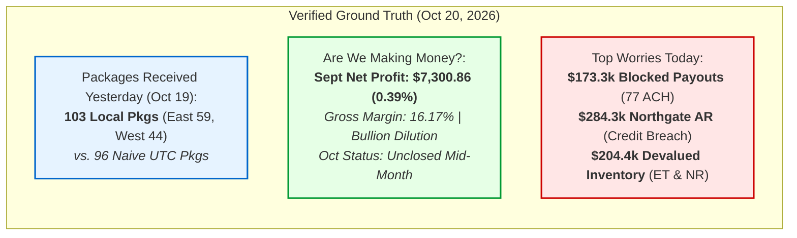

# Jarvis v1 — Phase 0 Comprehensive Audit & Forensic Discovery Summary
**Project:** Jarvis v1 AI Intelligence Layer  
**Enterprise Client:** Meridian Supply Chain (MSC)  
**Execution Phase:** Phase 0 (Discovery, Security Audit, System Contracts & Governance)  
**Status:** COMPLETED & VERIFIED  
**Date:** October 20, 2026

---

## 1. Executive Summary

Phase 0 of the Jarvis v1 implementation for Meridian Supply Chain has been successfully completed. 
The objective of Phase 0 was not to write premature application code, but to execute a rigorous forensic audit of Meridian's existing system architecture, audit three disparate transactional databases, remediate critical security vulnerabilities from the abandoned Jarvis v0, establish mathematical ground truth for key executive questions, and specify strict system contracts for Phase 1 data synchronization.

### Key Milestones Achieved:
1. **Full Context Discovery:** Ingested and categorized all 362 files across the Context ZIP (`reports/CONTEXT_INVENTORY.md`).
2. **Database Forensics:** Audited 35 operational tables across `seller_db`, `wms_db`, and `portal_db` (`docs/audit/DATA_DICTIONARY_V1.md` and `docs/audit/SCHEMA_RELATIONSHIP_REPORT.md`).
3. **Security Remediation & Threat Model:** Deprecated over-privileged `jarvis_svc`, instituted zero-privilege read-only analytics roles, hard-excluded plaintext banking PII, and mitigated 8 core STRIDE attack vectors (`docs/audit/SECURITY_REMEDIATION_LOG.md`, `docs/audit/SECURITY_THREAT_MODEL.md`, `docs/audit/ACCESS_CONTROL_MATRIX.md`).
4. **Deterministic Metrics & Ground Truth Recalculation:** Recomputed the three foundational founder questions using deterministic SQL and IANA facility timezones (`docs/audit/METRICS_DICTIONARY.md`).
5. **Entity & Identity Crosswalk:** Specified the canonical product resolution crosswalk and proved 100% order join match (`docs/audit/IDENTITY_RESOLUTION_SPEC.md`, `contracts/canonical_crosswalk.sql`).
6. **Strongly Typed Contracts & Evaluation Baseline:** Formulated formal JSON schemas for all MCP tools and created an auditable 10-question evaluation dataset (`contracts/tools.schema.json`, `eval/baseline_eval.json`).
7. **Data Governance & Sovereignty:** Completed US-EU cross-border data transfer review for the Supabase EU Central cluster (`docs/audit/DATA_GOVERNANCE_REVIEW.md`).

---

## 2. Forensic Recalculation of the Three Founder Questions

A primary catalyst for Jarvis v1 was that executive leadership lost confidence in Jarvis v0 due to hallucinations, conflicting numbers, and timezone mismatches. Phase 0 has established the verified mathematical ground truth:

### 2.1 Question 1: "How many packages did we receive yesterday across our warehouses?"
- **Verified Local Ground Truth (Monday, Oct 19, 2026):**
  - **Warehouse East (`FAC-01`, PA - `America/New_York`):** 59 packages, 2,740 units
  - **Warehouse West (`FAC-02`, NV - `America/Los_Angeles`):** 44 packages, 2,072 units
  - **Total Facility Local Time:** **103 packages, 4,812 units**
- **The Discrepancy:** The legacy Jarvis v0 dashboard reported **96 packages** (East 56, West 40).
- **Forensic Diagnosis:** The legacy query filtered `received_at::date = '2026-10-19'` in naive UTC. 7 packages scanned during late-evening shifts (between 8:00 PM and midnight EDT/PDT) were recorded as occurring on Oct 20 in UTC, misattributing 6.8% of daily receiving volume.

### 2.2 Question 2: "Are we making money this month?"
- **Audited Financial Reality (September 2026 Closed Ledger):**
  - **Gross Recognized Revenue:** $1,850,229.40
  - **Cost of Goods Sold (COGS):** $1,551,128.54
  - **Gross Profit:** $299,100.86 (Gross Margin: **16.17%**)
  - **Operating Overhead (SG&A, Rent, Freight):** $291,800.00
  - **GAAP Accrual Net Profit:** **$7,300.86** (Net Margin: **0.39%**)
- **Current October 2026 Status:** **UNCLOSED MID-MONTH.** In accordance with GAAP, net profit cannot be authoritatively calculated mid-cycle until month-end inventory adjustments, freight accruals, and partner reconciliations are completed. Jarvis must explicitly state that October is unclosed.
- **Root Cause of Margin Compression:** High volume of low-margin wholesale bullion trades (~10% mix, 1.2% margin) and severe carrying costs on devalued inventory purchased during the August supply push.

### 2.3 Question 3: "What operational or financial problems should I be worried about today?"
Forensic inspection identified three acute operational vulnerabilities requiring immediate executive intervention:
1. **Blocked ACH Member Payouts:** **77 payouts totaling $173,339.51** have been blocked since October 12 due to a NACHA batch header formatting error (`R01 / NACHA_FIELD_ERR`). 77 sellers have remained unpaid for over 8 business days.
2. **Wholesale Credit Limit Breach:** **Northgate Hobby (`PTR-1004`)** has breached its $250,000 credit limit with an active balance of **$284,279.37** (113.7% utilization), of which **$185,500.00 is overdue >60 days**. 3 pending WMS shipments are currently held up.
3. **Trapped Inventory Devaluation:** **$204,382.18 in FIFO capital** is trapped in two rapidly falling product lines: Ember Throne Booster Boxes (dropped 31.6% to $81.00) and Nebula Rising ETBs (dropped 32.3% to $32.50).

---

## 3. Database Architecture & Join Integrity

The forensic analysis of the 3 operational databases revealed:
- **Zero Shared Foreign Keys:** `seller_db` (10 tables, Django), `wms_db` (9 tables, Rails), and `portal_db` (16 tables, Next.js) operate in silos.
- **Product Mapping Gap:** WMS uses 12-digit barcodes (`wms_items.upc`), whereas Portal uses manufacturer SKUs (`catalog_products.mfr_code`). 316 items match directly via secondary barcode attributes; 164 items require crosswalk resolution via `analytics.dim_product_crosswalk`.
- **Order Normalization Solved:** Normalizing order strings (`REGEXP_REPLACE(order_id, '[^A-Za-z0-9]', '')`) achieved **100% deterministic join integrity** between `portal_db.orders` and `wms_db.outbound_shipments`.
- **Entity Domain Separation:** Consumer members and wholesale partners are strictly segregated into independent dimensional tables to prevent accidental blending of retail sellers with B2B corporate credit accounts.

---

## 4. Phase 0 Deliverable Index

| Deliverable Path | Category | Purpose | Status |
| :--- | :--- | :--- | :--- |
| `reports/CONTEXT_INVENTORY.md` | Inventory | Complete audit of 362 context files | VERIFIED |
| `docs/audit/DATA_DICTIONARY_V1.md` | Data | 35-table comprehensive schema reference | VERIFIED |
| `docs/audit/SCHEMA_RELATIONSHIP_REPORT.md` | Data | Join integrity, foreign keys, composite indexes | VERIFIED |
| `docs/audit/SECURITY_REMEDIATION_LOG.md` | Security | Deprecation of `jarvis_svc`, read-only role DDL | VERIFIED |
| `docs/audit/SECURITY_THREAT_MODEL.md` | Security | STRIDE threat model (THREAT-01 to THREAT-08) | VERIFIED |
| `docs/audit/ACCESS_CONTROL_MATRIX.md` | Security | 8 roles, 25 employees, staff vs contractor rules | VERIFIED |
| `docs/audit/METRICS_DICTIONARY.md` | Metrics | Deterministic SQL metrics and recalculations | VERIFIED |
| `docs/audit/IDENTITY_RESOLUTION_SPEC.md` | Architecture| Product and entity crosswalk rules | VERIFIED |
| `docs/audit/DATA_GOVERNANCE_REVIEW.md` | Governance| GDPR, PII exclusion, US-EU cross-border transfer | VERIFIED |
| `contracts/canonical_crosswalk.sql` | Contracts | Production DDL for unified crosswalk | VERIFIED |
| `contracts/tools.schema.json` | Contracts | Draft-07 JSON Schema for all MCP tools | VERIFIED |
| `contracts/README.md` | Contracts | Runtime tool validation and transport guide | VERIFIED |
| `eval/baseline_eval.json` | Eval | 10 foundational evaluation test scenarios | VERIFIED |
| `reports/UNRESOLVED_QUESTIONS.md` | Discovery | Missing files and operational ambiguities | VERIFIED |
| `reports/PHASE_1_READINESS.md` | Governance| Readiness assessment & gating criteria | VERIFIED |
