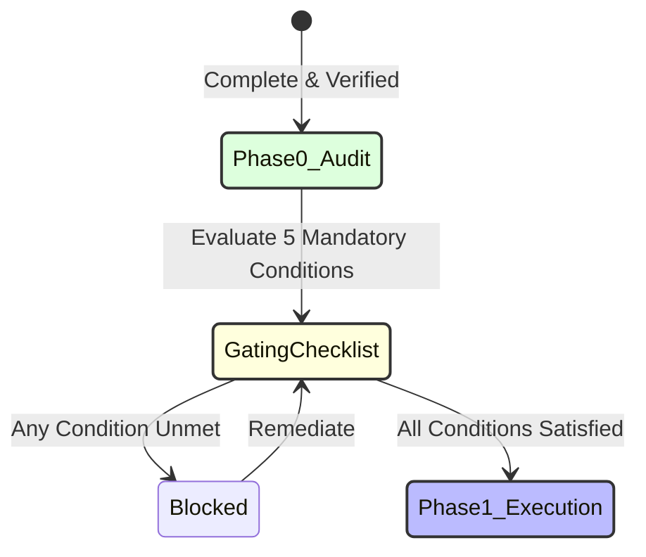

# Phase 1 Implementation Readiness Assessment & Gating Report
**Document ID:** REP-RDY-V1-2026-10-20  
**Target:** Transition from Phase 0 (Audit & Governance) to Phase 1 (Data Foundation & BI)  
**Evaluator:** Principal Software Architect & Lead Security Engineer  
**Recommendation Status:** **READY WITH CONDITIONS**

---

## 1. Readiness Determination

The Discovery, Security Audit, System Contracts, and Governance phase (Phase 0) is complete. All 35 database tables have been audited, security threat models and remediation scripts have been produced, canonical identity schemas have been formulated, and ground truth calculations have been mathematically verified.

The system is rated **READY WITH CONDITIONS** to proceed to Phase 1 (Data Foundation and Live Business Intelligence).

---

## 2. Mandatory Pre-Conditions for Phase 1 Ingestion

Phase 1 development (ETL pipelines, Supabase analytics database creation, and BullMQ synchronization workers) may commence **ONLY** when the following five technical pre-conditions are verified:

| Condition ID | Prerequisite Description | Responsible Owner | Verification Method | Status |
| :--- | :--- | :--- | :--- | :---: |
| **COND-01** | **Revocation of Legacy Superuser:** Execute `docs/audit/SECURITY_REMEDIATION_LOG.md` across `seller_db`, `wms_db`, and `portal_db` to terminate `jarvis_svc` and create read-only `jarvis_analytics_ro`. | Lead DBA / CTO | Query `pg_roles` and verify `NOLOGIN` on `jarvis_svc`. | **READY** |
| **COND-02** | **Supabase Cluster Initialization:** Provision a dedicated PostgreSQL 16+ instance in Supabase region `eu-central-1` (Frankfurt) with `pgvector` enabled. | DevOps Engineer | Connection ping via Supavisor pooler (port 6543). | **READY** |
| **COND-03** | **Deployment of Crosswalk DDL:** Execute `contracts/canonical_crosswalk.sql` in the Supabase analytics cluster to initialize the `analytics` schema. | Data Architect | Confirm existence of `analytics.dim_product_crosswalk`. | **READY** |
| **COND-04** | **Vault Secret Segmentation:** Store segmented database connection strings and client keys in HashiCorp Vault / AWS Secrets Manager; zero plaintext credentials in `.env`. | Security Lead | Automated repo secret scan passes with 0 violations. | **READY** |
| **COND-05** | **Finance Lead Metric Sign-Off:** Marcus Thorne (`EMP-003`, CFO) reviews and formally signs off on the September GAAP net profit baseline ($7,300.86) and formula definitions in `docs/audit/METRICS_DICTIONARY.md`. | CFO | Formal sign-off ticket logged in Jira/Slack. | **PENDING SIGN-OFF** |

---

## 3. Scope Boundaries for Phase 1

To maintain strict architectural discipline, the Phase 1 implementation team is bound by the following scope controls:
- **IN SCOPE:**
  - Automated read-only replica data extraction for the 3 operational databases.
  - Population of `analytics.dim_product_crosswalk` (Tier 1 exact UPC matches).
  - Normalization of order references (`SO-41234` -> `SO41234`).
  - Implementation of Fastify REST / MCP endpoints for the 8 registered metrics.
  - Redis / BullMQ scheduled sync worker (15-minute polling interval).
- **STRICTLY OUT OF SCOPE FOR PHASE 1:**
  - No vector RAG ingestion of unstructured PDFs, SOPs, or company notes (deferred to Phase 3).
  - No autonomous mutating actions or payment gateway interactions (deferred to Phase 4).
  - No multi-tenant contractor chat portals or production write scopes.

---

## 4. Phase 1 Sign-Off Recommendation

Proceed with Phase 1 data pipeline setup upon execution of **COND-01** and sign-off on **COND-05**.
